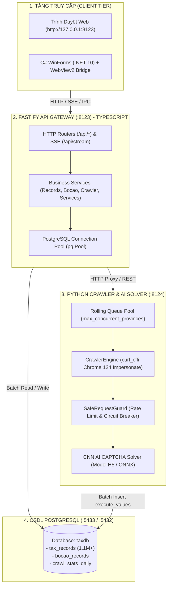

# 🏗️ ARCHITECTURE.md — Kiến Trúc Hệ Thống GDT Tax Crawler

> **Dự án:** GDT Tax Crawler & Multi-Province Search Engine  
> **Phiên bản:** 3.5.0 | **Chuẩn kiến trúc:** Multi-tier Modular Architecture  

---

## 1. Sơ Đồ Kiến Trúc Hệ Thống Tổng Thể

Hệ thống hoạt động theo mô hình phân tầng đa tiến trình, kết hợp giữa tốc độ I/O cao của TypeScript Fastify, sức mạnh tính toán xử lý ảnh của Python, giao diện Vue 3 hiện đại và trình bao bọc Desktop C# .NET 10 WinForms:

---

## 2. Ranh Giới 4 Phân Hệ & Trách Nhiệm (Separation of Concerns)

### 2.1. Fastify API Gateway (`src/` - Port :8123)
- **Công nghệ:** Node.js, Fastify, TypeScript strict mode, `@fastify/cors`, `@fastify/static`.
- **Trách nhiệm:** Điểm tiếp nhận duy nhất cho toàn bộ Frontend và Desktop. Điều phối API tra cứu, đối soát Bố cáo ĐKKD, phát luồng Server-Sent Events (SSE) theo dõi tiến độ thời gian thực.
- **Quy chuẩn:** Phân rã theo module (`bocao`, `crawler`, `enrichment`, `htkk`, `provinces`, `records`, `services`, `stream`), 100% tệp $\le 180$ dòng.

### 2.2. Frontend Vue 3 SPA (`frontend/src/`)
- **Công nghệ:** Vue 3 (Composition API), Vite, Tailwind CSS, TypeScript.
- **Trách nhiệm:** Hiển thị Dashboard quản trị đa tab: Vét cạn đa tỉnh, Bố cáo ĐKKD, Báo cáo sản lượng & Sức khỏe tỉnh thành, Quản trị dịch vụ hệ thống (Service Manager).
- **Quy chuẩn:** Đóng gói SFC `.vue`, tái sử dụng API Client tập trung (`src/api/client.ts`), 100% tệp $\le 180$ dòng.

### 2.3. Desktop Control GUI (`service_gui_csharp/`)
- **Công nghệ:** C# .NET 10 Windows Forms, Microsoft.Web.WebView2.
- **Trách nhiệm:** Trình điều khiển Native cho Windows Server. Cung cấp WebView2 Bridge hai chiều (`WebViewBridge.cs`), quản lý Start/Stop/Reset các Windows Service, kiểm tra cổng mạng và thu nhỏ System Tray.

### 2.4. Python Crawler & AI Core (`crawler_core/`, `server_app/` - Port :8124)
- **Công nghệ:** Python 3.10+, FastAPI, `curl_cffi`, TensorFlow CNN, `psycopg2.pool`.
- **Trách nhiệm:** Bắn request cào dữ liệu qua F5 WAF, tự giải CAPTCHA cục bộ trong <30ms, duy trì Rolling Queue 3 luồng đồng thời và tự động dừng khi gặp 20 mã không tồn tại liên tiếp.

---

## 3. Luồng Dữ Liệu & Hợp Đồng Bất Biến (Data Invariants)

1. **Bảo toàn WAF F5:** Mọi truy vấn hướng ra `tracuuhoadon.gdt.gov.vn` bắt buộc đi qua `SafeRequestGuard` với `max_global_rps <= 32`. Kích hoạt Circuit Breaker tạm dừng khi gặp HTTP 403 / "Request Rejected".
2. **Batch Persistence:** Lưu dữ liệu doanh nghiệp theo lô (`execute_values` trong Python hoặc `UNNEST` trong TypeScript), không ghi đơn lẻ từng dòng.
3. **Session Reuse:** Giữ nguyên session cookies và context TLS qua nhiều request để tối thiểu hóa số lần giải CAPTCHA.
