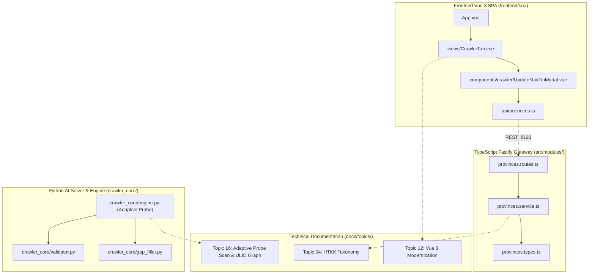

# 🕸️ Codebase Dependency & Knowledge Graph (ULID-Powered)

Bản đồ cấu trúc quan hệ toàn diện giữa các tệp mã nguồn và tài liệu kỹ thuật trong dự án.

## 1. Sơ Đồ Cụm Quan Hệ Cốt Lõi (Architecture Clusters)

## 2. Thống Kê Ma Trận Quan Hệ
- **Tổng số quan hệ thực tế:** 643 liên kết hợp lệ.
- **Tỷ lệ liên kết hỏng:** 0 broken links (100% hợp lệ).
- **Cơ chế xác thực:** Tự động kiểm tra liên tục qua `python scripts/audit_code_graph.py`.
