# Walkthrough: Khắc Phục Triệt Để Sự Cố "GUI Không Tự Cập Nhật Lại Được"

> **Mã số phiên làm việc:** STT 101  
> **Thời gian hoàn thành:** 2026-10-14 01:20:00  
> **Trạng thái:** ✅ ĐÃ KHẮC PHỤC TOÀN DIỆN & NGHIỆM THU THÀNH CÔNG

---

## 1. Nguyên Nhân Gốc Rễ Đã Xác Định (Root Cause Analysis)

Khi người dùng phản ánh: *"gui không tự cập nhật lại được"*, qua phân tích sâu vào luồng thực thi Runtime và nhật ký hệ thống (`logs/gui_20261014.log`), chúng tôi đã tìm ra 3 nguyên nhân cốt lõi:

```mermaid
flowchart TD
    subgraph Bug1["Sự Cố 1: Xung Đột Instance Tiến Trình"]
        P1["Bản Debug cũ (PID 14408)<br/>chạy ngầm từ 00:59"] -->|Chiếm Mutex| M1["Khóa Mutex SingleInstance"]
        P2["Bản Release mới build<br/>khởi động"] -->|Thấy Mutex bị chiếm| M2["Tự động thoát & chuyển sang PID 14408 cũ"]
        M2 --> R1["❌ Người dùng luôn nhìn thấy GUI cũ chưa cập nhật"]
    end

    subgraph Bug2["Sự Cố 2: Proxy SSE Bị Timeout 30 Giây"]
        H1["MainForm.WebView.cs: httpClient.Timeout = 30s"] -->|Hết 30 giây stream| H2["HttpClient ném ngoại lệ Timeout"]
        H2 -->|Proxy trả về 503| H3["EventSource (/api/stream) rơi vào onerror"]
        H3 --> R2["❌ useSSE.ts không đóng eventSource, không reconnect<br/>=> Stream đóng băng vĩnh viễn"]
    end

    subgraph Bug3["Sự Cố 3: useServiceManager Bị Chặn Auto-Poll"]
        S1["useServiceManager.ts có dòng:<br/>if (isNative.value) return;"] -->|Chặn poll khi chạy Desktop| S2["Tab Dịch Vụ không tự động fetch"]
        S2 --> R3["❌ Nút 'Làm Mới' bị vô hiệu, dữ liệu không nhảy số"]
    end
```

---

## 2. Các Giải Pháp & Tối Ưu Đã Thực Hiện

### 2.1. Giải Phóng Tiến Trình Cũ & Đồng Bộ Cấu Hình Build
- Đã chấm dứt tiến trình bản Debug cũ (`PID 14408`) đang chiếm giữ Mutex `GDTTaxCrawlerManager_SingleInstance_Mutex`.
- Biên dịch đồng bộ cả **`Release`** và **`Debug`** (`service_gui_csharp/bin/Release` & `service_gui_csharp/bin/Debug`) để đảm bảo bất kỳ phương thức khởi chạy nào cũng mở đúng phiên bản mới nhất 100%.

### 2.2. Bổ Sung StreamHttpClient Riêng Biệt Cho SSE (Timeout Vô Hạn)
- **`service_gui_csharp/MainForm.WebView.cs` (177 dòng):**
  - Khởi tạo riêng `streamHttpClient` với `Timeout = Timeout.InfiniteTimeSpan` và `PooledConnectionLifetime = 1h`.
  - Khi proxy chuyển tiếp URL `/api/stream`, sử dụng `streamHttpClient` thay vì `httpClient` 30s.
  - Loại bỏ hoàn toàn tình trạng stream SSE bị ngắt sau mỗi 30 giây.

### 2.3. Cơ Chế Tự Động Kết Nối Lại & Fallback Polling Cho SSE
- **`frontend/src/composables/useSSE.ts` (83 dòng):**
  - Bổ sung cơ chế tự động dọn dẹp và kết nối lại (`auto-reconnect`) trong `eventSource.onerror`:
    * Đóng kết nối cũ (`eventSource.close()`).
    * Gán `eventSource = null`.
    * Đặt lịch thử kết nối lại sau 2 giây (`setTimeout(() => connectSSE(), 2000)`).
  - Tích hợp thêm **Fallback Polling Timer** (mỗi 3.5 giây): Nếu trạng thái `sseConnected == false`, tự động fetch `/api/reports/crawl-stats` để cập nhật số liệu `total_db_records` trên thanh Master Metrics.

### 2.4. Bỏ Chặn Polling & Kích Hoạt Auto-Refresh 2.5 Giây Cho Services Tab
- **`frontend/src/composables/useServiceManager.ts` (172 dòng):**
  - Xóa bỏ điều kiện `if (isNative.value) return;` trong `pollWebFallback`.
  - Khởi động timer định kỳ `setInterval(pollWebFallback, 2500)` cho **cả chế độ C# Native IPC lẫn Web Browser**.
  - Hàm `refreshServices()` (nút "↻ Làm Mới") được kết nối trực tiếp để nạp lại dữ liệu ngay lập tức khi người dùng click.

---

## 3. Kết Quả Xác Minh & Kiểm Thử Nghiệm Thu

1. **Kiểm tra TypeScript & Line Limits:**
   - `npm run check:types`: **0 errors**.
   - `npm run check:lines`: **100% tệp tuân thủ $\le 180$ dòng**.
2. **Kiểm tra Build Frontend SPA:**
   - `npm run build`: Thành công trong 4.44s.
3. **Kiểm tra Build C# Desktop GUI:**
   - `dotnet build -c Release`: **0 Warning(s), 0 Error(s)**.
   - `dotnet build -c Debug`: **0 Warning(s), 0 Error(s)**.
4. **Kiểm tra Tiến Trình Đang Chạy:**
   - Không còn instance cũ chạy ngầm.
   - Sẵn sàng khởi động qua `run_csharp_gui.bat` hoặc tệp `.exe`.
