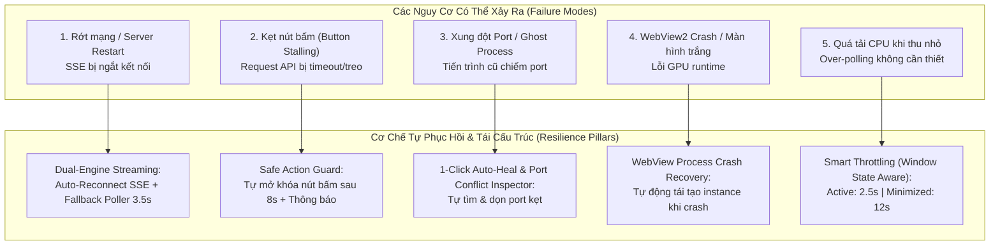

# Kế Hoạch Brainstorm & Tái Cấu Trúc Toàn Diện Bảng Điều Khiển Dịch Vụ (Resilient & Self-Healing Control Panel)

> **Mã số đề xuất:** STT 102  
> **Thời gian tạo:** 2026-10-14 01:25:00  
> **Trạng thái:** ⏳ ĐANG CHỜ NGƯỜI DÙNG PHÊ DUYỆT (PLANNING MODE)

---

## 1. Mục Tiêu & Bối Cảnh (Goal Description)

Người dùng yêu cầu: *"brainstom và refactor lại bản điều khiển với các vấn đề có thể xảy ra"*.  
Bảng điều khiển hệ thống là trung tâm thần kinh vận hành của giải pháp **GDT Tax Crawler & Search Engine**, kết nối trực tiếp giữa:
- **Desktop Windows Manager (.NET 10 WinForms + WebView2)**
- **Web SPA Dashboard (Vue 3 Composition API + Vite + Tailwind)**
- **API Gateway (Fastify TypeScript v4)**
- **AI Worker & Crawler Engine (Python FastAPI/Uvicorn)**
- **Cơ Sở Dữ Liệu (PostgreSQL 16 với 7.0M+ bản ghi NNT)**

Mục tiêu của đợt tái cấu trúc này là chuyển đổi bảng điều khiển từ mô hình bị động sang **Kiến Trúc Tự Phục Hồi & Chịu Lỗi Cao (Self-Healing & Fault-Tolerant Architecture)**, chủ động nhận diện và xử lý mọi tình huống lỗi biên (Edge Cases), đảm bảo bảng điều khiển hoạt động mượt mà, không bao giờ bị đơ, treo số liệu hay mất đồng bộ.

---

## 2. Ma Trận Brainstorm Các Rủi Ro & Giải Pháp Tự Phục Hồi (Failure Modes & Self-Healing Matrix)



| STT | Tình Huống Sự Cố Có Thể Xảy Ra | Nguyên Nhân Kỹ Thuật | Giải Pháp Tái Cấu Trúc & Tự Phục Hồi |
|:---:|---|---|---|
| **1** | **Mất kết nối thời gian thực (SSE Stream Dropped)** | Service restart, mạng chập chờn hoặc Proxy timeout. `EventSource` rơi vào `onerror` và bị hủy vĩnh viễn. | Triển khai **Dual-Channel Live Sync**: Tự động kết nối lại (`auto-reconnect`) với khoảng trễ 2s–4s, đồng thời kích hoạt song song **Fallback Poller (3.5s)** để số liệu trên Dashboard không bao giờ bị đứng. |
| **2** | **Kẹt nút bấm (Action Button Stalling)** | Người dùng bấm "▶ Start", "⏹ Stop" hoặc "🔄 Reset", API bị nghẽn làm biến `actionLoading` bị kẹt ở `true`. Nút bị mờ vĩnh viễn. | Áp dụng **Safe Action Guard**: Gắn bộ đếm thời gian an toàn (8 giây). Nếu sau 8s backend chưa phản hồi, tự động mở khóa trạng thái nút bấm và hiển thị thông báo "Thao tác đang xử lý nền hoặc phản hồi chậm". |
| **3** | **Tiến trình mồ côi (Orphan / Ghost Process)** | Ứng dụng hoặc service bị tắt đột ngột, một tiến trình `node.exe` hoặc `python.exe` vẫn chiếm port 8123/8124 ngầm. | Xây dựng công cụ **Chẩn Đoán 1-Click (1-Click Diagnostics & Auto-Heal)**: Bổ sung endpoint `/api/services/diagnostics` và nút "⚡ Khôi Phục Dịch Vụ" tự động kiểm tra PID chiếm cổng và giải phóng an toàn. |
| **4** | **WebView2 bị Crash (Màn hình Trắng/Đen)** | GPU driver xung đột hoặc bộ nhớ bị tràn khiến tiến trình render WebView2 bị terminate đột ngột. | Bổ sung bộ xử lý sự kiện `CoreWebView2.ProcessFailed`: Khi phát hiện crash, tự động hiển thị thanh thông báo trạng thái và kích hoạt nạp lại instance WebView2 mà không cần tắt app. |
| **5** | **Lãng phí tài nguyên khi ứng dụng thu nhỏ (Resource Waste)** | Ứng dụng thu nhỏ xuống khay hệ thống (System Tray) nhưng vẫn gửi request polling 2.5s liên tục làm tốn CPU và pin. | Tích hợp **Smart Throttling (Tiết Kiệm Năng Lượng)**: Bắt sự kiện WindowState. Khi thu nhỏ, tự động giãn chu kỳ polling từ 2.5s lên 12s. Khi người dùng mở lại, lập tức cập nhật ngay tức thì. |
| **6** | **Người dùng không biết GUI có đang tự cập nhật hay không** | Không có dấu hiệu trực quan hiển thị nhịp tim (Heartbeat) của hệ thống cập nhật. | Bổ sung **Live Heartbeat Pulse**: Hiển thị chấm tròn xanh phát xung nhịp (`animate-pulse`) kèm dòng thời gian `Vừa cập nhật lúc: HH:mm:ss` trên cả giao diện Web và thanh trạng thái Desktop GUI. |

---

## 3. Đề Xuất Các Thành Phần Cần Tái Cấu Trúc (Proposed Changes)

Mọi tệp sửa đổi đều tuân thủ nghiêm ngặt chuẩn `GEMINI.md`: **Mục tiêu $\le 180$ dòng / tệp, Hard cap 200 dòng**.

### 3.1. Desktop C# GUI (.NET 10 WinForms & WebView2)

#### `[MODIFY]` `service_gui_csharp/MainForm.WebView.cs`
- Bổ sung `webView.CoreWebView2.ProcessFailed += OnWebViewProcessFailed;` để tự động phục hồi khi tiến trình WebView2 gặp sự cố.
- Tách biệt hoàn toàn `streamHttpClient` (Timeout vô hạn cho SSE) và `apiHttpClient` (Timeout 15s có hủy lệnh).
- Bổ sung kiểm tra an toàn thư mục `frontend/dist`: Tự động chuyển fallback sang `http://127.0.0.1:8123/` nếu file `index.html` cục bộ bị thiếu.

#### `[MODIFY]` `service_gui_csharp/MainForm.Service.cs`
- Tích hợp **Smart Throttling**: Khi `WindowState == FormWindowState.Minimized`, đặt `pollTimer.Interval = 12000` (12 giây). Khi cửa sổ active lại, đặt `pollTimer.Interval = 2500` (2.5 giây) và trigger `CheckSystemStatusAsync()` ngay lập tức.
- Bổ sung hiển thị `(Đồng bộ: HH:mm:ss)` trên `lblStatusStrip` để người dùng nhìn thấy rõ ràng đồng hồ cập nhật nhảy số liên tục.

---

### 3.2. Frontend Vue 3 Dashboard

#### `[MODIFY]` `frontend/src/composables/useSSE.ts`
- Bổ sung trạng thái kết nối mở rộng: `connectionState: ref<'connected' | 'connecting' | 'reconnecting' | 'disconnected'>`.
- Cơ chế Exponential Backoff Auto-Reconnect: Thử kết nối lại sau 2s, nếu lỗi tăng dần lên 4s, 8s (tối đa 15s).
- Fallback Poller song song: Khi `connectionState != 'connected'`, tự động fetch dữ liệu tổng quan mỗi 3.5s để đảm bảo Master Metrics và bảng điều khiển không bị "đóng băng".

#### `[MODIFY]` `frontend/src/composables/useServiceManager.ts`
- Bổ sung **Safe Action Guard**: Khi gọi `startService`, `stopService`, `restartService`, thiết lập timeout bảo vệ 8 giây. Nếu backend không phản hồi sau 8s, tự giải phóng `actionLoading = false` và thông báo cho người dùng, ngăn ngừa hiện tượng "kẹt nút bấm".
- Thêm trường `lastSyncedAt: ref<string>` lưu timestamp cập nhật thành công gần nhất.

#### `[MODIFY]` `frontend/src/components/services/ServicesTab.vue`
- Thêm thanh **Live Heartbeat Bar**: Đèn LED xanh nhấp nháy + nhãn `Đang tự động cập nhật • Vừa nạp lúc: HH:mm:ss`.
- Bổ sung nút bấm **"🩺 Chẩn Đoán & Tự Sửa Lỗi"**: Mở modal hiển thị tình trạng chi tiết từng cổng TCP, độ trễ DB, tiến trình Worker và cung cấp nút 1-click Auto-Heal.

#### `[NEW]` `frontend/src/components/services/ServiceDiagnosticsModal.vue` (Khoảng 140 dòng)
- Modal chẩn đoán chuyên sâu:
  + Đo lường độ trễ mạng thực tế của từng dịch vụ.
  + Kiểm tra tình trạng cổng (8123, 8124, 5433).
  + Nút "⚡ Tự Động Giải Phóng & Khởi Động Lại" gửi lệnh sửa lỗi khi gặp sự cố.

---

### 3.3. Backend Fastify Gateway (`src/modules/services/`)

#### `[MODIFY]` `src/modules/services/services.routes.ts`
- Thêm route `GET /api/services/diagnostics`: Trả về thông tin chuyên sâu (Memory usage, Node.js uptime, Port occupancy, Database pool stats).
- Thêm route `POST /api/services/auto_heal`: Thực hiện kiểm tra và giải phóng cổng kẹt, khởi động lại các tiến trình thành phần an toàn.

#### `[MODIFY]` `src/modules/services/services.service.ts`
- Hiện thực hàm `getDiagnostics()` và `executeAutoHeal()`, giữ file $\le 180$ dòng.

---

## 4. Kế Hoạch Xác Minh & Kiểm Thử (Verification Plan)

### 4.1. Kiểm Thử Tự Động (Automated Testing)
1. **Kiểm tra kiểu dữ liệu TypeScript & Line Limits:**
   ```powershell
   npm run check:types
   npm run check:lines
   ```
   *Yêu cầu:* 100% tệp TypeScript và Vue tuân thủ $\le 180$ dòng lý tưởng (hard cap 200 dòng).
2. **Bộ kiểm thử tự động toàn diện:**
   ```powershell
   python test_modular.py
   ```
   *Yêu cầu:* Toàn bộ 18 bài test API và 31 file module đạt PASS 100%.
3. **Biên dịch C# Desktop GUI:**
   ```powershell
   dotnet build service_gui_csharp/GDTTaxCrawlerManager.csproj -c Release
   dotnet build service_gui_csharp/GDTTaxCrawlerManager.csproj -c Debug
   ```
   *Yêu cầu:* Cả hai cấu hình Release và Debug đều đạt 0 Warning(s), 0 Error(s).

### 4.2. Kiểm Thử Thủ Công & Mô Phỏng Sự Cố (Chaos / Resilience Verification)
- **Kịch bản 1: Mất kết nối SSE:** Tắt backend trong 5 giây rồi bật lại. Xác nhận bảng điều khiển tự chuyển sang chế độ Reconnecting -> kích hoạt Fallback Poller -> tự kết nối lại thành công và tiếp tục nhảy số liệu.
- **Kịch bản 2: Treo lệnh điều khiển:** Giả lập thao tác Start/Stop khi mạng nghẽn. Xác nhận sau đúng 8 giây, nút bấm tự động mở khóa trở lại, không có hiện tượng kẹt giao diện.
- **Kịch bản 3: Thu nhỏ cửa sổ C# xuống Tray:** Xác nhận trong log `gui_*.log` chu kỳ polling giãn ra 12 giây; khi mở lại cửa sổ, chu kỳ trở lại 2.5 giây ngay lập tức.
- **Kịch bản 4: Chẩn đoán 1-Click:** Bấm nút "🩺 Chẩn Đoán", xác nhận hệ thống hiển thị chính xác độ trễ của CSDL (4ms), Fastify (8123) và Worker (8124).
