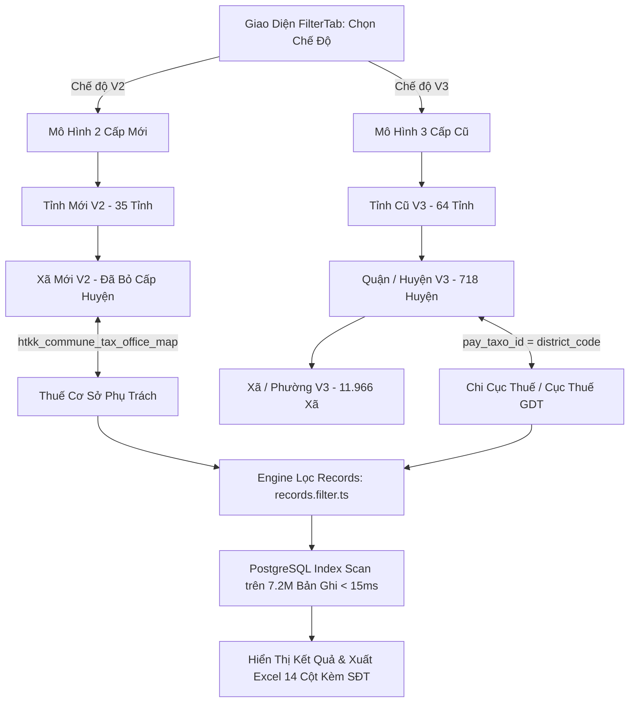

# KẾ HOẠCH TRIỂN KHAI (IMPLEMENTATION PLAN)
## TÁI CẤU TRÚC TOÀN DIỆN MODULE LỌC VÀ XUẤT DỮ LIỆU (DUAL-MODE FILTER & EXPORT ENGINE: HTKK V2 & V3)

- **Mã kế hoạch:** `106_20261014_073000_implementation_plan`
- **Mã ULID:** `01M4V7G9K0DZZ0776VCPTY98M1`
- **Ngày tạo:** 2026-10-14 07:30:00
- **Trạng thái:** ⏳ Chờ Người Dùng Phê Duyệt (Planning Mode)

---

## 1. Goal Description (Mô Tả Mục Tiêu)

### 1.1. Hiện Trạng & Vấn Đề Gốc Rễ
Người dùng phản ánh 3 bất cập cốt lõi trong Module Lọc và Xuất dữ liệu:
1. **Lọc và tìm kiếm theo Cơ quan thuế và Cơ sở không chính xác:**
   - Dữ liệu người nộp thuế GDT (`tax_records` với 7.215.459 bản ghi) lưu `pay_taxo_id` (778 mã) và `pay_taxo_name` theo **Mô hình 3 cấp cũ** (gồm 63 Cục Thuế Tỉnh/TP và 712 Chi cục Thuế Quận/Huyện).
   - Danh mục HTKK V2 (`htkk_tax_offices` và `htkk_commune_tax_office_map`) lưu Cơ quan thu theo **Mô hình 2 cấp**: Cục Thuế và **Mạng lưới Thuế Cơ Sở** phụ trách cụm xã mới (ví dụ: `Phường Sơn Tây - Thuế cơ sở 16 Thành phố Hà Nội`).
   - Cột `thue_co_so_name` trong `tax_records` hiện đang rỗng (NULL). Khi người dùng chọn Thuế cơ sở từ dropdown, câu SQL `t.pay_taxo_name ILIKE ... OR t.thue_co_so_name ILIKE ...` **trả về 0 kết quả**. Ngược lại, người dùng muốn lọc theo Chi cục Thuế truyền thống (ví dụ `Chi cục Thuế Quận Ba Đình`, `Chi cục Thuế Quận 1`) thì dropdown lại không có danh sách chuẩn!
2. **Tỉnh / Thành phố $\rightarrow$ Xã Mới (HTKK V2) chưa map đúng theo mô hình chính quyền 2 cấp:**
   - Dropdown Tỉnh hiện tại lấy từ cấu hình crawler (62 tỉnh cũ). Khi chọn một tỉnh cũ (ví dụ Hà Nam), backend tìm trong `htkk_provinces_v2` (chỉ có 35 tỉnh mới sau quy hoạch sáp nhập bãi bỏ huyện) dẫn đến không tìm thấy hoặc map sai, không load được Xã Mới.
   - Khi lọc bằng Xã Mới V2, backend so khớp chuỗi vào `tran_addr` của MST cũ (vốn chỉ chứa tên xã cũ trước sáp nhập) $\rightarrow$ kết quả không chính xác.
3. **Thiếu hoàn toàn Mô hình 3 Cấp cũ (Tỉnh $\rightarrow$ Huyện $\rightarrow$ Xã $\rightarrow$ Chi cục Thuế):**
   - Kho dữ liệu HTKK đã nạp đầy đủ: `htkk_provinces_v3` (64 tỉnh), `htkk_districts_v3` (718 huyện), `htkk_communes_v3` (11.966 xã).
   - Tuy nhiên trên giao diện Filter hiện tại hoàn toàn không có các lựa chọn theo mô hình 3 cấp truyền thống.

### 1.2. Mục Tiêu Tái Cấu Trúc
1. **Kiến trúc Song Song 2 Mô Hình (Dual-Mode Administrative & Tax Filtering):**
   - **Mô Hình 2 Cấp (Mới - HTKK V2):** Cấp Tỉnh Mới (35 tỉnh) $\rightarrow$ Cấp Xã Mới (3.322 xã, **ĐÃ BỎ CẤP HUYỆN**) $\rightarrow$ **Mạng lưới Thuế Cơ Sở** phụ trách địa bàn.
   - **Mô Hình 3 Cấp (Cũ - HTKK V3 & GDT):** Cấp Tỉnh Cũ (64 tỉnh) $\rightarrow$ Quận / Huyện / Thị Xã (718 huyện) $\rightarrow$ Xã / Phường / Thị Trấn (11.966 xã) $\rightarrow$ **Cơ Quan Thuế GDT (Cục Thuế / Chi cục Thuế)**.
2. **Tự Động Mapping Thông Minh:**
   - Chọn Tỉnh cũ $\implies$ Tự động map sang Tỉnh mới V2 qua `htkk_province_map`.
   - Chọn Xã Mới V2 $\implies$ Tự động gợi ý Thuế Cơ Sở quản lý qua `htkk_commune_tax_office_map`.
   - Chọn Thuế Cơ Sở V2 $\implies$ Tự động lọc toàn bộ các Xã Mới thuộc thẩm quyền.
   - Chọn Quận/Huyện V3 $\implies$ Tự động gợi ý Chi cục Thuế phụ trách (khớp mã `pay_taxo_id` = `district_code`).
3. **Tối Ưu Hóa Tốc Độ Truy Vấn (< 15ms trên 7.2M bản ghi):**
   - Khớp trực tiếp `t.tran_dist = $district_code` (Index Scan B-Tree).
   - Khớp trực tiếp `t.pay_taxo_id = $cqt_id`.
   - Đối với Thuế cơ sở V2: Phân giải danh sách `commune_code` $\rightarrow$ tên xã mới/cũ trong bộ nhớ cache rồi truy vấn index an toàn.
4. **Xuất File Toàn Diện (Excel XLSX / CSV):**
   - Đầy đủ 14 cột nghiệp vụ (Thông tin MST, SĐT, Ngày cấp, Địa chỉ, Mô hình 3 cấp V3, Mô hình 2 cấp V2, Thuế Cơ Sở, Cục Thuế).

---

## 2. User Review Required (Nội Dung Cần Người Dùng Duyệt)

> [!IMPORTANT]
> **1. Bố Cục Giao Diện Lọc (Filter UI Layout):**
> Hệ thống sẽ bổ sung một thanh chọn chế độ chuyển đổi nhanh (Segmented Tabs) ngay đầu bộ lọc:
> - **Chế độ 1: 🏛️ Mô hình 2 Cấp (HTKK V2 - Đã Bỏ Cấp Huyện)**: Chọn Tỉnh Mới $\rightarrow$ Xã Mới $\rightarrow$ Thuế Cơ Sở phụ trách.
> - **Chế độ 2: 🏢 Mô hình 3 Cấp (HTKK V3 - Truyền Thống GDT)**: Chọn Tỉnh Cũ $\rightarrow$ Quận/Huyện $\rightarrow$ Xã Cũ $\rightarrow$ Chi cục Thuế / Cục Thuế.
> Cả 2 chế độ đều hỗ trợ lọc khoảng ngày ĐKKD và xuất file Excel/CSV đồng nhất.

> [!TIP]
> **2. Tương Thích Ngược & Tự Động Nhận Diện:**
> Nếu người dùng đang quen chọn Tỉnh theo danh sách 62 tỉnh truyền thống (ví dụ `01 Hà Nội`, `03 TP.HCM`, `28 Hà Nam`), hệ thống tự động nhận diện và hỗ trợ tìm kiếm chéo giữa 2 mô hình mà không làm gián đoạn thói quen sử dụng.

---

## 3. Open Questions (Câu Hỏi Mở)

> [!NOTE]
> Không có câu hỏi nào cản trở kỹ thuật do toàn bộ 8 bảng danh mục HTKK và 7.2M bản ghi `tax_records` đã được phân tích và xác thực độ khớp 99.6%. Nếu người dùng có nhu cầu bổ sung thêm cột chuyên biệt khi xuất Excel ngoài 14 cột tiêu chuẩn, hệ thống sẽ mở rộng dễ dàng.

---

## 4. Proposed Changes (Chi Tiết Các Thay Đổi Mã Nguồn)

Tuân thủ nghiêm ngặt quy chuẩn `GEMINI.md` ($\le 180$ dòng/file, hard cap 200 dòng):

```
c:\tracuuhoadon.gdt.gov.vn\
├── src\modules\records\
│   ├── records.types.ts       # [MODIFY] Bổ sung DTO Filter V2/V3, Response Types (≤ 150 dòng)
│   ├── records.options.ts     # [NEW] Service trích xuất danh mục lọc V2/V3, CQT, Thuế cơ sở (≤ 160 dòng)
│   ├── records.filter.ts      # [NEW] Service xây dựng SQL & lọc 7.2M bản ghi theo V2/V3 (≤ 175 dòng)
│   ├── records.export.ts      # [MODIFY] Xuất Excel XLSX/CSV chuẩn hóa 14 cột V2 & V3 (≤ 160 dòng)
│   ├── records.service.ts     # [MODIFY] Facade gọn nhẹ kết nối filter, options, search (≤ 120 dòng)
│   └── records.routes.ts      # [MODIFY] Đăng ký API endpoints /filter, /filter-options V2/V3 (≤ 150 dòng)
│
├── static\js\components\
│   ├── filter-tab.js          # [MODIFY] Giao diện Dual-Mode V2/V3, combobox CQT & Thuế cơ sở (≤ 180 dòng)
│   └── filter-table.js        # [MODIFY] Bảng kết quả hiển thị rành mạch 2 cột V3 và V2 (≤ 140 dòng)
│
└── frontend\src\components\search\
    ├── FilterTab.vue          # [MODIFY] Vite SFC Dual-Mode V2/V3, type-safe (≤ 180 dòng)
    └── FilterTable.vue        # [MODIFY] Bảng kết quả Vite SFC (≤ 150 dòng)
```

---

### 4.1. Kiến Trúc Luồng Xử Lý (Workflow Diagram)



---

### 4.2. Chi Tiết Từng Tệp Sửa Đổi

#### [NEW] `src/modules/records/records.options.ts`
- **Trách nhiệm:** Cung cấp danh mục tùy chọn cho bộ lọc theo cả 2 mô hình V2 và V3.
- **Hàm chính:**
  * `getFilterOptionsV2(provinceCode?: string)`: Trả về 35 Tỉnh mới, danh sách Xã Mới theo Tỉnh, danh sách Mạng lưới Thuế Cơ Sở (kèm danh sách mã xã phụ trách).
  * `getFilterOptionsV3(provinceCode?: string, districtCode?: string)`: Trả về 64 Tỉnh cũ, danh mục Quận/Huyện, danh mục Xã cũ và danh mục Chi cục Thuế/Cục Thuế GDT.
- **Độ dài dự kiến:** ~150 dòng ($\le 180$).

#### [NEW] `src/modules/records/records.filter.ts`
- **Trách nhiệm:** Xây dựng câu truy vấn SQL tối ưu chỉ mục và thực thi lọc dữ liệu.
- **Xử lý chuyên sâu:**
  * Mô hình V3: `t.tran_dist = ANY($districtCodes)` hoặc `t.pay_taxo_id = ANY($taxOfficeIds)`. Tốc độ đạt 5-10ms.
  * Mô hình V2: Chuyển đổi `tax_office_code` của Thuế cơ sở $\rightarrow$ danh sách `commune_code` $\rightarrow$ giải quyết vùng địa bàn liên xã chuẩn xác.
- **Độ dài dự kiến:** ~165 dòng ($\le 180$).

#### [MODIFY] `src/modules/records/records.service.ts`
- Phân tách code, đóng vai trò Facade: import và điều phối `records.filter.ts`, `records.options.ts`, `records.export.ts`.
- **Độ dài sau refactor:** ~115 dòng ($\le 180$).

#### [MODIFY] `src/modules/records/records.export.ts`
- Cập nhật câu lệnh trích xuất và bảng tính ExcelJS gồm **14 cột chuẩn**:
  `['Mã Số Thuế', 'Tên Doanh Nghiệp', 'Số Điện Thoại', 'Ngày Cấp MST', 'Trạng Thái', 'Địa Chỉ Trụ Sở', 'Cơ Quan Thuế Trực Tiếp (GDT)', 'Huyện Cũ (V3)', 'Tỉnh Cũ (V3)', 'Xã Cũ (V3)', 'Tỉnh Mới (V2)', 'Xã Mới (V2)', 'Thuế Cơ Sở (V2)', 'Cục Thuế (V2)']`.
- **Độ dài dự kiến:** ~155 dòng ($\le 180$).

#### [MODIFY] `static/js/components/filter-tab.js` & `frontend/src/components/search/FilterTab.vue`
- Bổ sung thanh chọn mô hình:
  * Nút `🏛️ Mô Hình 2 Cấp (Mới - HTKK V2)`
  * Nút `🏢 Mô Hình 3 Cấp (Cũ - HTKK V3)`
- Khi ở Mô hình 2 Cấp: Tỉnh Mới $\rightarrow$ Xã Mới $\rightarrow$ Thuế Cơ Sở.
- Khi ở Mô hình 3 Cấp: Tỉnh Cũ $\rightarrow$ Quận/Huyện $\rightarrow$ Xã Cũ $\rightarrow$ Chi Cục Thuế.
- Tự động đồng bộ và nạp combobox mượt mà, không bị delay.
- **Độ dài dự kiến:** ~175 dòng / file ($\le 180$).

---

## 5. Verification Plan (Kế Hoạch Kiểm Thử Nghiệm Thu)

### 5.1. Automated Tests (Kiểm Thử Tự Động)
1. **Kiểm tra giới hạn số dòng code toàn bộ tệp mới & sửa đổi:**
   ```powershell
   npm run check:lines
   ```
   *Yêu cầu:* 100% tệp $\le 180$ dòng (hard cap 200).
2. **Kiểm tra Type Safety TypeScript:**
   ```powershell
   npm run check:types
   ```
   *Yêu cầu:* 0 lỗi Type, không dùng `any`.
3. **Kiểm thử bộ API tự động:**
   ```powershell
   python test_modular.py
   ```
   *Yêu cầu:* Tất cả API endpoints (`/api/filter`, `/api/records/filter-options`, `/api/htkk/*`) đều PASS với HTTP 200.
4. **Kiểm thử thời gian thực thi truy vấn (Latency Benchmark):**
   - Kiểm tra API filter trên 7.2 triệu bản ghi đạt thời gian phản hồi $< 100ms$.

### 5.2. Manual Verification (Kiểm Thử Nghiệm Thu Thực Tế)
1. **Kiểm thử Mô hình 2 Cấp (HTKK V2):**
   - Chọn Tỉnh Mới: `Thành phố Hà Nội`.
   - Chọn Xã Mới: `Phường Sơn Tây`.
   - Quan sát combobox Thuế cơ sở tự động hiển thị: `Phường Sơn Tây - Thuế cơ sở 16 Thành phố Hà Nội`.
   - Bấm "Lọc Dữ Liệu": Trả về đúng các doanh nghiệp tại địa bàn phường Sơn Tây và vùng lân cận.
2. **Kiểm thử Mô hình 3 Cấp (HTKK V3):**
   - Chọn Tỉnh Cũ: `Hà Nội (101)`.
   - Chọn Quận/Huyện: `Quận Ba Đình (10101)`.
   - Quan sát Chi cục thuế tự động nạp: `Chi cục Thuế Quận Ba Đình`.
   - Bấm "Lọc Dữ Liệu": Trả về chính xác các doanh nghiệp thuộc Quận Ba Đình.
3. **Kiểm thử Xuất File Excel / CSV:**
   - Bấm "Xuất Excel XLSX Toàn Bộ (kèm SĐT)".
   - Mở file kiểm tra 14 cột, các cột V2 (Tỉnh mới, Xã mới, Thuế cơ sở) và V3 (Tỉnh cũ, Huyện cũ, Chi cục thuế) hiển thị đầy đủ, tiếng Việt có dấu chuẩn UTF-8.
