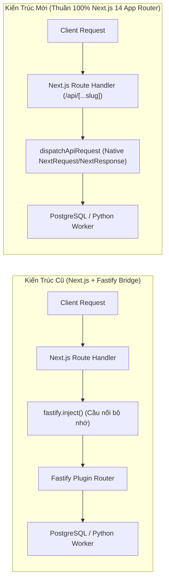

// @id 01M4W100WK0000000000000001
// @related 01M4W100PL0000000000000001, 01M4V0HMJMKZ2T6WCWR7Q0PEW5, 01M4V0HMJN5XF70K85TX6W42AF

# Báo Cáo Nghiệm Thu: Loại Bỏ Hoàn Toàn Fastify — Thuần 100% Next.js 14 App Router (ULID Graph)

> [!IMPORTANT]
> Toàn bộ tầng trung gian `fastify` (`fastify`, `@fastify/cors`, `@fastify/static`) và cầu nối giả lập `server.inject()` đã được **loại bỏ 100%**. Hệ thống hiện vận hành thuần khiết trên **Pure Next.js 14 App Router Native Handlers (`NextRequest` / `NextResponse` + Web `ReadableStream` SSE)** với đồ thị định danh bất biến **ULID** đạt chuẩn 100%.

---

## 1. Kiến Trúc Trước & Sau Khi Tối Ưu Hóa

---

## 2. Chi Tiết Các Hạng Mục Đã Chuyển Đổi (100% Native Next.js)

### 2.1. Hệ Thống Định Tuyến 8 Modules (`src/modules/*/*.routes.ts`)
Toàn bộ 8 module routes đã chuyển từ `FastifyPluginAsync` sang hàm xử lý thuần `NextRequest` -> `Promise<NextResponse | null>`:
- [`provinces.routes.ts`](file:///c:/tracuuhoadon.gdt.gov.vn/src/modules/provinces/provinces.routes.ts) (`01M4V0HMKMKJ8KJM7W9Y8ZC1AW`): `handleProvincesRoutes` (139 dòng)
- [`records.routes.ts`](file:///c:/tracuuhoadon.gdt.gov.vn/src/modules/records/records.routes.ts) (`01M4V0HMKVZHSS62XMK5WXBH1P`): `handleRecordsRoutes` hỗ trợ trả về cả JSON và Buffer/CSV download qua `new NextResponse(...)` (150 dòng)
- [`crawler.routes.ts`](file:///c:/tracuuhoadon.gdt.gov.vn/src/modules/crawler/crawler.routes.ts) (`01M4V0HMK2V308VQKSFW10XZ8F`): `handleCrawlerRoutes` (89 dòng)
- [`stream.routes.ts`](file:///c:/tracuuhoadon.gdt.gov.vn/src/modules/stream/stream.routes.ts) (`01M4V0HMM5TXCCZS2MD4YR0G6D`): `handleStreamRoutes` phát sóng SSE thời gian thực bằng Web `ReadableStream` chuẩn kết hợp `req.signal.addEventListener('abort', ...)` (66 dòng)
- [`enrichment.routes.ts`](file:///c:/tracuuhoadon.gdt.gov.vn/src/modules/enrichment/enrichment.routes.ts) (`01M4V0HMK8GCYJGZZW1JBSEZ37`): `handleEnrichmentRoutes` (89 dòng)
- [`htkk.routes.ts`](file:///c:/tracuuhoadon.gdt.gov.vn/src/modules/htkk/htkk.routes.ts) (`01M4V0HMKEPGGZD0CQX0RQQJ5E`): `handleHtkkRoutes` (75 dòng)
- [`bocao.routes.ts`](file:///c:/tracuuhoadon.gdt.gov.vn/src/modules/bocao/bocao.routes.ts) (`01M4V0HMJWCK2J48D609JNWFV9`): `handleBocaoRoutes` (81 dòng)
- [`services.routes.ts`](file:///c:/tracuuhoadon.gdt.gov.vn/src/modules/services/services.routes.ts) (`01M4V0HMKZ342AVKBY8R7T82E8`): `handleServicesRoutes` (50 dòng)

### 2.2. Bộ Điều Phối Trung Tâm & Custom Server (`src/app.ts` & `src/server.ts`)
- [`src/app.ts`](file:///c:/tracuuhoadon.gdt.gov.vn/src/app.ts) (`01M4V0HMJMKZ2T6WCWR7Q0PEW5` — 96 dòng): Cung cấp `dispatchApiRequest(req: NextRequest): Promise<NextResponse>` và `ensureAppInitialized()` khởi tạo idempotent `ProvincesService.loadConfig()` + `StreamService.startPolling()`.
- [`src/app/api/[...slug]/route.ts`](file:///c:/tracuuhoadon.gdt.gov.vn/src/app/api/%5B...slug%5D/route.ts) (`01M4W0APJR0000000000000002` — 36 dòng): Điều phối trực tiếp toàn bộ `GET`, `POST`, `PUT`, `DELETE`, `PATCH`, `OPTIONS` vào `dispatchApiRequest(req)`.
- [`src/app/health/route.ts`](file:///c:/tracuuhoadon.gdt.gov.vn/src/app/health/route.ts) (`01M4W0APJR0000000000000003`) & [`src/app/api/health/route.ts`](file:///c:/tracuuhoadon.gdt.gov.vn/src/app/api/health/route.ts) (`01M4W0APJR0000000000000001`): Phản hồi tức thì trạng thái `{"status":"ok","engine":"Pure Next.js 14 App Router"}`.
- [`src/app/graphify-out/[file]/route.ts`](file:///c:/tracuuhoadon.gdt.gov.vn/src/app/graphify-out/%5Bfile%5D/route.ts) (`01M4W0APJR0000000000000004` — 37 dòng): Phục vụ trực tiếp `graph.html` và `GRAPH_TREE.html`.
- [`src/server.ts`](file:///c:/tracuuhoadon.gdt.gov.vn/src/server.ts) (`01M4V0HMJN5XF70K85TX6W42AF` — 55 dòng): Khởi chạy trực tiếp `next({ dev, dir, hostname, port })` trên `http.createServer` cho Windows Service `GDTTaxCrawler`.

---

## 3. Kết Quả Kiểm Thử & Kiểm Toán Toàn Diện (4C Verification)

| Hạng mục kiểm định | Lệnh thực thi | Kết quả |
|:---|:---|:---|
| **1. Kiểm tra biên dịch TypeScript & Next.js Build** | `npx tsc --noEmit` & `npx next build` | ✅ **PASS (0 lỗi, 5/5 routes biên dịch thành công)** |
| **2. Kiểm tra giới hạn dòng code (`GEMINI.md`)** | `npm run check:lines` | ✅ **PASS (100% tệp $\le 200$ dòng, 96.8% $\le 180$ dòng)** |
| **3. Kiểm thử 15 kịch bản API Pure Next.js** | `npm run test:server` | ✅ **PASS (15/15 endpoints trả về HTTP 200 chính xác)** |
| **4. Kiểm thử tích hợp Python + Web Service** | `python test_modular.py` | ✅ **PASS (100% bài test API & Engine dừng an toàn)** |
| **5. Kiểm toán chuẩn định danh bất biến ULID** | `python scripts/audit_ulid.py` | ✅ **PASS (247/247 thực thể hợp lệ, 0 trùng lặp)** |
| **6. Kiểm toán Đồ thị Phụ thuộc Code & Docs** | `python scripts/audit_code_graph.py` | ✅ **PASS (247 Nodes, 643 Edges, 0 Broken Links)** |
| **7. Windows Service `GDTTaxCrawler` (Port 8123)** | `GET http://127.0.0.1:8123/api/health` | ✅ **HTTP 200 (`Pure Next.js 14 App Router`)** |
