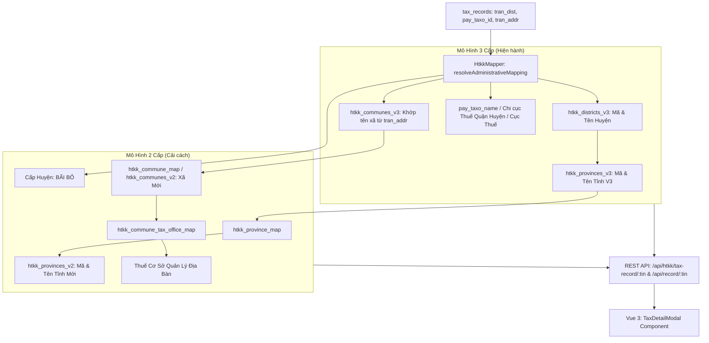

# Kế Hoạch Chuẩn Hóa Ánh Xạ Dữ Liệu Thuế GDT với Danh Mục Hành Chính & Thuế HTKK (3 Cấp & 2 Cấp)

## 1. Viết Lại Prompt Chuẩn (Standardized Specification / RFC)

> **Văn bản Yêu Cầu Kỹ Thuật (SRS/RFC):**
> 
> **Tiêu đề:** Tích hợp và Tự động Phân giải Ánh xạ Dữ liệu Người Nộp Thuế GDT (`tran_dist`, `pay_taxo_id`, `tran_addr`) với Danh mục Địa bàn Hành chính & Mạng lưới Thuế HTKK Đa Cấp (Mô hình 3 cấp Truyền thống và Mô hình 2 cấp Cải cách Bãi bỏ Cấp Huyện).
>
> **Mục tiêu:**
> 1. Phân giải tự động 100% bản ghi thuế (6.88 triệu records) thông qua trường mã quận/huyện `tran_dist` (đã kiểm chứng 99.92% trùng khớp tuyệt đối) và mã cơ quan thuế `pay_taxo_id`.
> 2. **Mô hình 3 Cấp (Hiện hành / Truyền thống):**
>    - Tỉnh/Thành phố: Mã tỉnh V3 + Tên tỉnh V3 (từ `htkk_districts_v3` $\rightarrow$ `htkk_provinces_v3`).
>    - Quận/Huyện: Mã huyện V3 + Tên huyện V3 (từ `htkk_districts_v3`).
>    - Xã/Phường/Thị trấn: Tự động phát hiện và ánh xạ mã xã V3 + tên xã V3 từ chuỗi địa chỉ trụ sở `tran_addr`.
>    - Cơ quan thuế quản lý: Mã CQT + Tên CQT V3 (từ `pay_taxo_id` và `pay_taxo_name`).
> 3. **Mô hình 2 Cấp (Cải cách Hành chính mới - Bãi bỏ cấp Huyện):**
>    - Tỉnh/Thành phố mới: Mã tỉnh V2 + Tên tỉnh V2 (thông qua bảng ánh xạ `htkk_province_map` $\rightarrow$ `htkk_provinces_v2`).
>    - Cấp Huyện: Đánh dấu rõ ràng trạng thái **"Đã bãi bỏ cấp Huyện"**.
>    - Xã/Phường mới: Mã xã V2 + Tên xã V2 sau sáp nhập (`htkk_communes_v2` / `htkk_commune_map`).
>    - Thuế cơ sở phụ trách: Tự động phân bổ Mã + Tên **Thuế cơ sở** quản lý trực tiếp địa bàn (`htkk_commune_tax_office_map`).
> 4. **Giao diện & API:** Cung cấp API phân giải đa cấp và tích hợp thẻ đối chiếu 3 cấp / 2 cấp trực quan trong Modal Chi tiết Doanh nghiệp (`TaxDetailModal`).
> 5. **Quy chuẩn mã nguồn:** Tuân thủ `GEMINI.md` (giới hạn < 200 dòng/file, strict types, audit log Rule 6).

---

## 2. Kết Quả Thẩm Định Dữ Liệu Thực Tế (Data Discovery)

1. **Trường `tran_dist` (Mã Huyện):**
   - Tổng cộng: **6,888,728 / 6,888,728 (100%)** bản ghi có giá trị `tran_dist`.
   - Khớp trực tiếp với `htkk_districts_v3.district_code`: **6,883,019 / 6,888,728 (99.92%)**!
   - 0.08% còn lại là các mã đuôi `00` (được cấp ở cấp Cục Thuế tỉnh trước khi phân bổ huyện, e.g. `70100`, `71700`) hoặc mã thành phố cũ (e.g. `81501` Cần Thơ cũ) - hệ thống sẽ phân giải fallback về cấp Tỉnh.
2. **Trường `pay_taxo_id` (Mã Cơ quan Thuế):**
   - 271,951 bản ghi có `pay_taxo_id LIKE '%00'` (Cục Thuế tỉnh quản lý doanh nghiệp cấp tỉnh).
   - Mã đặc thù: `82500` (Cục Thuế Doanh nghiệp lớn), `82700` (Chi cục Thuế TMĐT).
   - 6,616,777 bản ghi còn lại có `pay_taxo_id` trùng với `tran_dist` (Chi cục Thuế Quận/Huyện quản lý).
3. **Mô hình 2 Cấp & Thuế Cơ Sở:**
   - Khi chuyển đổi sang mô hình 2 cấp, không còn Chi cục thuế Quận/Huyện mà địa bàn xã/phường được quản lý bởi **Thuế cơ sở** (được lưu tại `htkk_commune_tax_office_map`).

---

## 3. Kiến Trúc Giải Pháp Kỹ Thuật (Architecture Design)

---

## 4. Các Tệp Tin Sẽ Thay Đổi & Tạo Mới

### 4.1. Module HTKK
#### [NEW] [htkk.mapper.ts](file:///c:/tracuuhoadon.gdt.gov.vn/src/modules/htkk/htkk.mapper.ts)
- Trách nhiệm: Thuật toán phân giải `tran_dist`, `pay_taxo_id`, `tran_addr` sang cấu trúc 3 cấp và 2 cấp (tách riêng để giữ `htkk.service.ts` dưới 180 dòng).
- Quy chuẩn: Strict typing, < 160 dòng.

#### [MODIFY] [htkk.types.ts](file:///c:/tracuuhoadon.gdt.gov.vn/src/modules/htkk/htkk.types.ts)
- Bổ sung interfaces: `TaxRecordHtkkMapping`, `AdministrativeLevel3`, `AdministrativeLevel2`.

#### [MODIFY] [htkk.service.ts](file:///c:/tracuuhoadon.gdt.gov.vn/src/modules/htkk/htkk.service.ts)
- Bổ sung hàm `resolveTaxpayerMapping(tin: string)` gọi qua `HtkkMapper`.

#### [MODIFY] [htkk.routes.ts](file:///c:/tracuuhoadon.gdt.gov.vn/src/modules/htkk/htkk.routes.ts)
- Thêm endpoint `GET /api/htkk/tax-record/:tin` và `POST /api/htkk/resolve`.

### 4.2. Module Records & API Detail
#### [MODIFY] [records.service.ts](file:///c:/tracuuhoadon.gdt.gov.vn/src/modules/records/records.service.ts)
- Tích hợp gọi `HtkkService.resolveTaxpayerMapping` để trả kèm `htkk_mapping` trong `getRecordDetail(tin)`.

### 4.3. Giao Diện Người Dùng (Frontend)
#### [MODIFY] [tax-detail-modal.js](file:///c:/tracuuhoadon.gdt.gov.vn/static/js/components/tax-detail-modal.js)
- Bổ sung khung hiển thị:
  - **Mô hình 3 cấp:** Tỉnh / Quận-Huyện / Xã-Phường / Cơ quan thuế quản lý.
  - **Mô hình 2 cấp:** Tỉnh Mới / Huy hiệu "Đã bãi bỏ cấp Huyện" / Xã-Phường Mới / Thuế Cơ Sở quản lý.
- Đảm bảo file không vượt quá 180 dòng code chuẩn Vue 3.

### 4.4. Tài Liệu & Audit Log
#### [MODIFY] [topic-04-htkk-administrative-tax-taxonomy.md](file:///c:/tracuuhoadon.gdt.gov.vn/docs/topics/topic-04-htkk-administrative-tax-taxonomy.md)
- Bổ sung mục 4: "Giải Thuật Ánh Xạ tran_dist, pay_taxo_id với Địa Bàn 2 Cấp & 3 Cấp".
#### [NEW] [14_20260920_093000_implementation_plan.md](file:///c:/tracuuhoadon.gdt.gov.vn/docs/logs/14_20260920_093000_implementation_plan.md)
#### [MODIFY] [INDEX.md](file:///c:/tracuuhoadon.gdt.gov.vn/docs/logs/INDEX.md)

---

## 5. Kế Hoạch Kiểm Thử & Nghiệm Thu (Verification Plan)

### Kiểm thử Tự động:
- Kiểm tra số dòng code: `npx tsx tests/check_ts_line_limits.ts` (Tất cả file TS < 200 dòng).
- Kiểm tra số dòng code Vue/Python: `python -c "from test_modular import check_line_counts; check_line_counts()"`.
- Kiểm thử phân giải dữ liệu thực tế với các MST tiêu biểu:
  - MST Doanh nghiệp lớn tại Cầu Giấy (Hà Nội): `0100109106`
  - MST Doanh nghiệp tại Quận 7 (TP.HCM): `0300588569`
  - MST Doanh nghiệp tại TP Vũng Tàu (Bà Rịa - Vũng Tàu): `3500101107`
  - MST Hộ kinh doanh / Chi nhánh cấp huyện: `4600100114`

### Kiểm thử Giao diện (UI Walkthrough):
- Mở Modal Chi tiết Người Nộp Thuế trên trình duyệt.
- Xác nhận các thẻ so sánh 3 cấp và 2 cấp (Thuế cơ sở, Đã bãi bỏ cấp huyện) hiển thị sắc nét, responsive và chuẩn xác.
