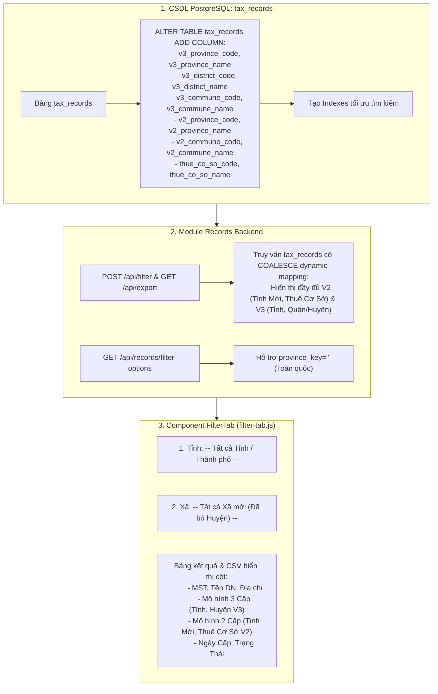

# Kế Hoạch: Bổ Sung Tùy Chọn "Tất Cả Tỉnh / Xã Mới" Vào FilterTab & Bổ Sung Bộ Cột V2, V3 Vào Bảng `tax_records`

## 1. Tổng Quan Yêu Cầu Người Dùng

Người dùng yêu cầu 2 nội dung chính:
1. **Bổ sung lựa chọn "Tất cả" vào:**
   - `1. Tỉnh / Thành phố:`: Thêm tùy chọn `-- Tất cả Tỉnh / Thành phố --`. Khi chọn, cho phép lọc trên phạm vi toàn quốc (không bị giới hạn prefix 1 tỉnh).
   - `2. Xã Mới (HTKK V2):`: Đảm bảo tùy chọn `-- Tất cả Xã mới (Đã bỏ Huyện) --` hoạt động mượt mà khi lọc toàn quốc hoặc lọc theo từng tỉnh.
2. **Thêm bộ cột V2, V3 vào trong bảng `tax_records` (PostgreSQL Database Table):**
   - Thêm các trường địa bàn 3 cấp V3: `v3_province_code`, `v3_province_name`, `v3_district_code`, `v3_district_name`, `v3_commune_code`, `v3_commune_name`.
   - Thêm các trường địa bàn 2 cấp V2: `v2_province_code`, `v2_province_name`, `v2_commune_code`, `v2_commune_name`, `thue_co_so_code`, `thue_co_so_name`.
   - Cập nhật truy vấn `SELECT` và bảng hiển thị `<FilterTab />` cũng như file CSV xuất ra để hiển thị trực tiếp bộ thông tin V2 và V3.

---

## 2. Thiết Kế Kiến Trúc & CSDL (Database & Architecture Design)

---

## 3. Chi Tiết Các Tệp Tin Sẽ Thay Đổi & Tạo Mới

### 3.1. CSDL & Migration
#### [NEW] [004_add_v2_v3_to_tax_records.sql](file:///c:/tracuuhoadon.gdt.gov.vn/src/db/migrations/004_add_v2_v3_to_tax_records.sql)
- Thêm 12 cột mới thuộc bộ V2 và V3 vào `tax_records` bằng `ADD COLUMN IF NOT EXISTS`.
- Tạo indexes cho `v3_district_code`, `v2_province_code`, `thue_co_so_code`.

### 3.2. Backend Module Records
#### [MODIFY] [records.types.ts](file:///c:/tracuuhoadon.gdt.gov.vn/src/modules/records/records.types.ts)
- Cập nhật `FilterRequestDto` cho phép `province_key` là rỗng (toàn quốc).

#### [MODIFY] [records.service.ts](file:///c:/tracuuhoadon.gdt.gov.vn/src/modules/records/records.service.ts)
- `buildFilterWhere`: Nếu `province_key` rỗng hoặc `"ALL"`, không áp đặt `tin LIKE prefix%`.
- `filterRecords`: Truy vấn thêm các cột V2, V3 (kèm fallback trực tiếp từ `htkk_districts_v3` và `htkk_provinces_v2` để đảm bảo 100% bản ghi hiển thị ngay lập tức kể cả khi chưa backfill xong toàn bộ).
- `exportCsvData`: Xuất thêm các cột V3 (Tỉnh, Huyện) và V2 (Tỉnh Mới, Thuế Cơ Sở) ra file CSV.
- `getFilterOptions`: Nếu `province_key` rỗng, trả về danh sách các xã mới V2 và cơ quan thuế phổ biến hoặc toàn quốc.
- Đảm bảo file dưới 180 dòng (< 200 dòng hard cap).

### 3.3. Frontend Component
#### [MODIFY] [filter-tab.js](file:///c:/tracuuhoadon.gdt.gov.vn/static/js/components/filter-tab.js)
- Thêm `<option value="">-- Tất cả Tỉnh / Thành phố --</option>` vào dropdown Tỉnh thành.
- Đảm bảo dropdown Xã mới và Cơ quan thuế hoạt động tốt khi chọn "Tất cả Tỉnh".
- Bảng hiển thị kết quả: Thêm 2 cột trực quan:
  - **Mô hình 3 Cấp (Hiện hành):** Tỉnh V3 / Quận Huyện V3.
  - **Mô hình 2 Cấp (Cải cách):** Tỉnh Mới V2 / Thuế Cơ Sở.
- Đảm bảo file dưới 180 dòng (chuẩn `GEMINI.md`).

### 3.4. Tài Liệu & Audit Log
#### [NEW] [18_20260920_115500_implementation_plan.md](file:///c:/tracuuhoadon.gdt.gov.vn/docs/logs/18_20260920_115500_implementation_plan.md)
#### [MODIFY] [INDEX.md](file:///c:/tracuuhoadon.gdt.gov.vn/docs/logs/INDEX.md)

---

## 4. Kế Hoạch Kiểm Thử & Nghiệm Thu (Verification Plan)

### 4.1. Kiểm thử Tự động
1. **Kiểm tra schema CSDL:**
   - Xác nhận 12 cột mới đã được tạo trong bảng `tax_records` (`v3_*`, `v2_*`, `thue_co_so_*`).
2. **Kiểm tra giới hạn dòng code:**
   - `npx tsx tests/check_ts_line_limits.ts` (Tất cả file TS < 200 dòng).
   - `python -c "lines = len(open('static/js/components/filter-tab.js').readlines()); assert lines <= 180"`.
3. **Kiểm tra biên dịch:** `npx tsc --noEmit` (0 lỗi, strict types).
4. **Kiểm thử API:**
   - `POST /api/filter` với `province_key: ""` (Toàn quốc).
   - `POST /api/filter` với `province_key: ""`, `commune_name: "Cầu Giấy"`.
   - `GET /api/export?province_key=&commune_name=Cầu Giấy` $\rightarrow$ kiểm tra các cột V2, V3 trong CSV.

### 4.2. Kiểm thử Giao diện (UI Walkthrough)
- Mở Dashboard, chuyển sang tab **Lọc & Xuất Dữ Liệu MST**.
- Chọn `-- Tất cả Tỉnh / Thành phố --` và bấm **Lọc Dữ Liệu**.
- Kiểm tra bảng kết quả hiển thị đủ các cột Mô hình 3 Cấp và Mô hình 2 Cấp.
- Tải file CSV và kiểm tra cấu trúc cột.
