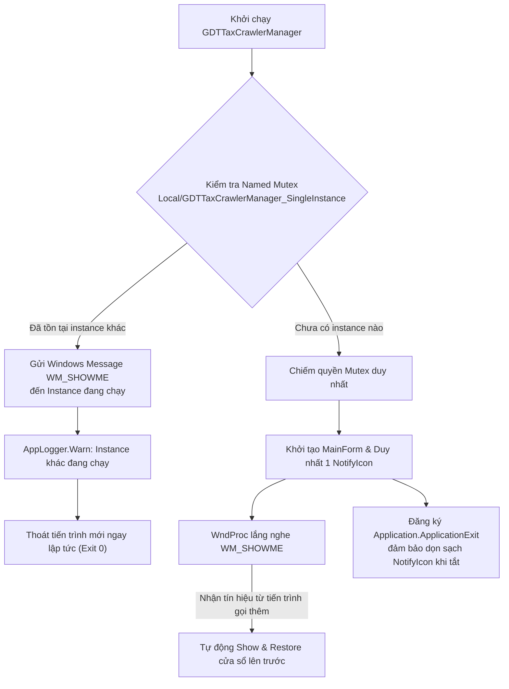

# Kế Hoạch Triển Khai: Cơ Chế Single-Instance & Xử Lý Triệt Để Trùng Lặp Icon System Tray

> **Mã kế hoạch:** `77_20261011_092500_implementation_plan.md`  
> **Topic liên quan:** [Topic 13: Nâng Cấp GUI Control Sang .NET 10 & Tích Hợp WebView2 Vue 3 Native](../topics/topic-13-net10-webview2-gui-control.md)  
> **Ngày lập:** 11/10/2026 — 09:25:00  
> **Tiêu chuẩn áp dụng:** `GEMINI.md` (< 180 dòng/file C#, zero warnings), `AGENTS.md`

---

## 1. Hiện Trạng & Nguyên Nhân Gốc Rễ (Root Cause Analysis)

Sau khi kiểm tra tiến trình thực tế trên hệ điều hành, phát hiện **6 tiến trình `GDTTaxCrawlerManager.exe` đang chạy ngầm đồng thời** (PID: 44224, 24408, 57056, 26044, 39536, 28056) khiến thanh khay hệ thống (System Tray) xuất hiện rất nhiều icon trùng lặp.

### Nguyên Nhân Kỹ Thuật:
1. **Thiếu cơ chế Single-Instance Mutex:** Ứng dụng chưa có bộ khóa định danh độc quyền (Named Mutex) ở cấp độ tiến trình. Mỗi lần người dùng nhấp đúp file `.bat` hoặc khởi chạy exe, một tiến trình hoàn toàn mới được sinh ra.
2. **Khởi tạo Tray Icon riêng biệt cho từng tiến trình:** Mỗi tiến trình khi nạp đều khởi tạo một `NotifyIcon` riêng trong `SetupTrayIntegration()`. Khi người dùng đóng cửa sổ (ẩn xuống khay theo cơ chế chạy ngầm), các tiến trình này tiếp tục tích lũy trong khay hệ thống.
3. **Cập nhật GDI Icon lặp lại không cần thiết:** Hàm `UpdateTrayIcon()` được gọi liên tục mỗi 2.5 giây từ `pollTimer`, dù trạng thái LED và dịch vụ không hề thay đổi.
4. **Hiện tượng "Ghost Tray Icon" khi thoát không dọn dẹp:** Nếu tiến trình bị tắt đột ngột mà không chạy qua `notifyIcon.Visible = false; notifyIcon.Dispose()`, Windows Shell vẫn giữ biểu tượng rác cho đến khi người dùng rê chuột qua.

---

## 2. Thiết Kế Giải Pháp Toàn Diện

### 2.1. Module Mới: `service_gui_csharp/SingleInstanceHelper.cs` (khoảng 50 dòng)
- Sử dụng `System.Threading.Mutex` với tên độc quyền `Local\GDTTaxCrawlerManager_App_SingleInstance`.
- Đăng ký thông điệp hệ thống Win32 `RegisterWindowMessage("WM_SHOW_GDT_TAX_CRAWLER_MANAGER")`.
- Phương thức `BroadcastShowExistingInstance()`: Gửi thông điệp `PostMessage(HWND_BROADCAST, ...)` yêu cầu cửa sổ hiện tại hiển thị lên màn hình.

### 2.2. Xử Lý Tại `Program.cs`
- Thử chiếm Mutex trước khi khởi chạy `ApplicationConfiguration.Initialize()`.
- Nếu Mutex đã tồn tại: Gọi `BroadcastShowExistingInstance()`, ghi log `AppLogger.Warn`, và kết thúc tiến trình ngay lập tức mà không tạo thêm bất kỳ Form hay Tray Icon nào.

### 2.3. Xử Lý Tại `MainForm.Tray.cs` & `MainForm.cs`
- Ghi đè `WndProc(ref Message m)` để bắt thông điệp `WM_SHOWME`: Khi người dùng bấm chạy lại ứng dụng, cửa sổ đang chạy ngầm trong tray sẽ tự động mở to và đưa lên phía trước (`ShowAndRestore()`).
- Tối ưu `UpdateTrayIcon`: Chỉ vẽ lại icon khi màu LED thực sự thay đổi (`if (ledColor == lastTrayColor) return;`).
- Đăng ký `Application.ApplicationExit` và `FormClosing` để luôn thực hiện `notifyIcon.Visible = false; notifyIcon.Dispose();` triệt tiêu 100% ghost icons.

---

## 3. Các Bước Triển Khai

1. **Bước 1: Tạo `service_gui_csharp/SingleInstanceHelper.cs`:**
   - Xây dựng lớp hỗ trợ Mutex và gửi thông điệp Win32 IPC.
2. **Bước 2: Cập nhật `Program.cs`:**
   - Bổ sung kiểm tra Single Instance ở dòng đầu hàm `Main()`.
3. **Bước 3: Cập nhật `MainForm.cs` & `MainForm.Tray.cs`:**
   - Bổ sung `WndProc` bắt thông điệp kích hoạt hiển thị.
   - Thêm bộ đệm màu `lastTrayColor` ngăn chặn vẽ icon lặp lại.
   - Đảm bảo giải phóng `notifyIcon` khi ứng dụng đóng.
4. **Bước 4: Biên dịch & Kiểm thử:**
   - Biên dịch: `dotnet build service_gui_csharp\GDTTaxCrawlerManager.csproj -c Release` (0 Warning, 0 Error).
   - Kiểm tra giới hạn dòng code (< 160 dòng/file).
   - Thử nghiệm khởi chạy nhiều lần liên tiếp để xác nhận chỉ có 1 tiến trình và 1 tray icon duy nhất tồn tại.
5. **Bước 5: Lập báo cáo nghiệm thu Walkthrough & Cập nhật nhật ký.**
