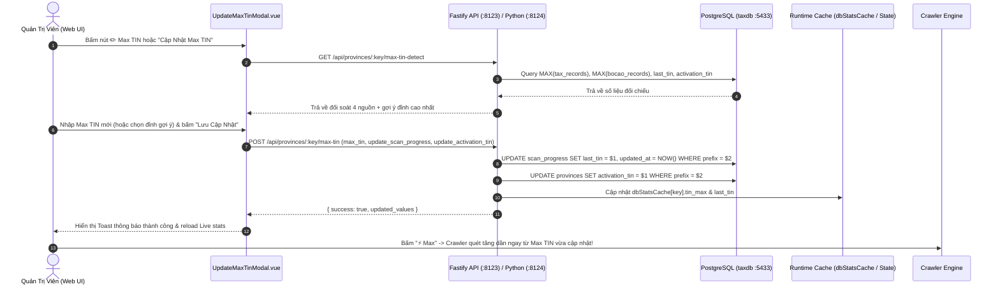

# Kế Hoạch Triển Khai: Chức Năng Cập Nhật Lại Max TIN Thủ Công

> **Mã kế hoạch liên kết:** STT 92  
> **Mã ULID Phiên:** `01M4V0TG7K99M0K8W6B1V7X6M0`  
> **Thời gian lập:** 2026-10-13 23:20:00 UTC+7  
> **Phạm vi:** Backend Fastify TypeScript (`src/modules/provinces/`), Python API (`server_app/routers/provinces.py`), và Frontend Vue 3 SPA (`frontend/src/components/crawler/`)

---

## 1. Mục Tiêu Kỹ Thuật & Bối Cảnh (Goal Description)

### 1.1. Vấn Đề Thực Tế
Trong quá trình vận hành hệ thống cào dữ liệu Người Nộp Thuế đa tỉnh:
1. **Lệch đỉnh mốc quét (TIN Max Drift):** Khi cào dữ liệu hoặc sau khi người dùng đối soát Bố Cáo / nhập dữ liệu ngoại tuyến, giá trị `last_tin` trong bảng `scan_progress` hoặc `activation_tin` trong bảng `provinces` có thể bị tụt hậu so với MST thực tế ngoài thị trường (hoặc bị ghi nhầm mốc).
2. **Nhu cầu can thiệp thủ công linh hoạt:** Khi người quản trị biết một mã số thuế mới nhất vừa được cấp trên masothue.com (ví dụ Đắk Lắk vừa lên `4900912345` trong khi hệ thống chỉ mới có `4900880000`), quản trị viên cần có công cụ trên giao diện Web để **nhập tay mốc Max TIN mong muốn** và kích hoạt crawler bắt đầu quét tăng dần (`newest`) ngay từ mốc đó, thay vì phải can thiệp trực tiếp vào database qua dòng lệnh SQL.
3. **Nhu cầu đồng bộ lại đỉnh từ CSDL (Auto-detect):** Cho phép hệ thống tự động quét tìm giá trị `MAX(tin)` thực tế giữa bảng `tax_records` và bảng `bocao_records` để cập nhật lại đỉnh cho một tỉnh hoặc toàn bộ 62 tỉnh bằng một nút bấm.

### 1.2. Mục Tiêu Đạt Được
- **Cập nhật thủ công (Manual Input):** Cho phép người dùng chọn tỉnh, nhập trực tiếp mã số thuế Max mới (10 số), kiểm tra tiền tố hợp lệ, cập nhật vào bảng `scan_progress` (`last_tin`), bảng `provinces` (`activation_tin`), và cập nhật bộ đệm runtime (`dbStatsCache`).
- **Phát hiện đỉnh tự động (Auto-Detect DB Max):** Cung cấp nút "⚡ Lấy Max Thực Tế Từ DB" đối chiếu song song giữa `tax_records` và `bocao_records` để người dùng xác nhận trước khi lưu.
- **Đồng bộ hàng loạt 62 tỉnh (Batch Sync):** Cho phép tính toán lại đỉnh cho toàn bộ 62 tỉnh thành.
- **Giao diện người dùng VDDS trực quan:** Modal chuyên nghiệp [`UpdateMaxTinModal.vue`](file:///c:/tracuuhoadon.gdt.gov.vn/frontend/src/components/crawler/UpdateMaxTinModal.vue) tích hợp nút mở từ Toolbar [`CrawlerTab.vue`](file:///c:/tracuuhoadon.gdt.gov.vn/frontend/src/components/crawler/CrawlerTab.vue) và nút chỉnh sửa nhanh ✏️ tại cột "TIN Max" trong [`CrawlerList.vue`](file:///c:/tracuuhoadon.gdt.gov.vn/frontend/src/components/crawler/CrawlerList.vue) và [`CrawlerGrid.vue`](file:///c:/tracuuhoadon.gdt.gov.vn/frontend/src/components/crawler/CrawlerGrid.vue).
- **Tuân thủ quy chuẩn:** Mỗi file mới và chỉnh sửa đều $\le 180$ dòng (hard cap 200 dòng theo [`GEMINI.md`](file:///c:/tracuuhoadon.gdt.gov.vn/GEMINI.md)), gắn header `@id <ULID>` và pass 100% các bộ test.

---

## 2. Kiến Trúc Luồng Dữ Liệu (Mermaid Diagram)



---

## 3. Đề Xuất Thay Đổi Chi Tiết (Proposed Changes)

### 3.1. Backend TypeScript (Fastify Gateway :8123)

#### [MODIFY] [`src/modules/provinces/provinces.types.ts`](file:///c:/tracuuhoadon.gdt.gov.vn/src/modules/provinces/provinces.types.ts)
- Bổ sung interface DTO:
  ```typescript
  export interface UpdateMaxTinDto {
    max_tin: string;
    update_scan_progress?: boolean;
    update_activation_tin?: boolean;
  }

  export interface ProvinceMaxTinDetectResult {
    province_key: string;
    prefix: string;
    current_max_tin: string | null;
    db_tax_max: string | null;
    db_bocao_max: string | null;
    last_scanned_tin: string | null;
    activation_tin: string | null;
    suggested_max_tin: string | null;
  }
  ```

#### [MODIFY] [`src/modules/provinces/provinces.service.ts`](file:///c:/tracuuhoadon.gdt.gov.vn/src/modules/provinces/provinces.service.ts)
- Bổ sung hàm:
  - `detectProvinceMaxTin(provKey: string): Promise<ProvinceMaxTinDetectResult>`:
    Thực hiện truy vấn song song tìm max tin từ `tax_records`, `bocao_records`, `scan_progress`, `provinces`.
  - `updateProvinceMaxTin(provKey: string, dto: UpdateMaxTinDto): Promise<{ success: boolean; message: string }>`:
    Cập nhật an toàn với câu lệnh `UPDATE scan_progress` và `UPDATE provinces`, sau đó cập nhật `dbStatsCache` và `provincesCache`.
  - `syncAllProvincesMaxTin(): Promise<{ synced_count: number }>`:
    Đồng bộ hàng loạt 62 tỉnh từ CSDL.

#### [MODIFY] [`src/modules/provinces/provinces.routes.ts`](file:///c:/tracuuhoadon.gdt.gov.vn/src/modules/provinces/provinces.routes.ts)
- Đăng ký các endpoints mới:
  - `GET /api/provinces/:key/max-tin-detect`: Lấy thông tin đối chiếu đỉnh.
  - `POST /api/provinces/:key/max-tin`: Thực hiện cập nhật thủ công.
  - `POST /api/provinces/sync-all-max-tin`: Đồng bộ hàng loạt 62 tỉnh.

---

### 3.2. Backend Python (AI Worker & Scraper :8124)

#### [MODIFY] [`server_app/routers/provinces.py`](file:///c:/tracuuhoadon.gdt.gov.vn/server_app/routers/provinces.py)
- Đồng bộ endpoint Python:
  - `@router.get("/api/provinces/{prov_key}/max-tin-detect")`
  - `@router.post("/api/provinces/{prov_key}/max-tin")`
  - `@router.post("/api/provinces/sync-all-max-tin")`
- Cập nhật trực tiếp `state.last_tins[prov_key]` và `PROVINCES_CACHE[prov_key]["activation_tin"]`.

---

### 3.3. Frontend Vue 3 SPA

#### [NEW] [`frontend/src/components/crawler/UpdateMaxTinModal.vue`](file:///c:/tracuuhoadon.gdt.gov.vn/frontend/src/components/crawler/UpdateMaxTinModal.vue) (Dưới 160 dòng)
- Component Modal độc lập chuẩn VNPT VDDS:
  - Props: `visible: boolean`, `initialProvinceKey: string`, `provinceConfigs: Record<string, ProvinceConfig>`.
  - Emits: `close`, `updated`.
  - Chọn tỉnh thành qua Select Box (kèm tìm kiếm).
  - Thẻ thông tin đối soát 4 chiều:
    * 🏛️ CSDL Thuế (`tax_records`): `{{ details.db_tax_max || 'Chưa có' }}`
    * 📰 Bố Cáo (`bocao_records`): `{{ details.db_bocao_max || 'Chưa có' }}`
    * 🕒 Scan Progress (`last_tin`): `{{ details.last_scanned_tin || 'Chưa có' }}`
    * ⚙️ Cấu Hình Tỉnh (`activation_tin`): `{{ details.activation_tin || 'Chưa có' }}`
  - Nút bấm nhanh: **"⚡ Chọn Đỉnh Cao Nhất"** (tự động gán `suggested_max_tin` vào ô nhập).
  - Input `Max TIN mới`: Validate regex `^[0-9]{10}$` và kiểm tra 2 số đầu trùng tiền tố tỉnh.
  - Checkboxes:
    - `[x] Cập nhật vào Tiến trình quét (scan_progress.last_tin)`
    - `[x] Cập nhật vào Mã khởi tạo tỉnh (provinces.activation_tin)`
  - Nút bấm "Lưu Cập Nhật" & Nút "Đồng Bộ 62 Tỉnh".

#### [NEW] [`frontend/src/api/provinces.ts`](file:///c:/tracuuhoadon.gdt.gov.vn/frontend/src/api/provinces.ts) (Dưới 60 dòng)
- Module API client riêng cho các thao tác với tỉnh thành để giữ cho [`frontend/src/api/client.ts`](file:///c:/tracuuhoadon.gdt.gov.vn/frontend/src/api/client.ts) luôn $\le 180$ dòng:
  ```typescript
  // @id 01M4V0TG7K99M0K8W6B1V7X6M1
  export const ProvincesApi = {
    async detectMaxTin(key: string) { ... },
    async updateMaxTin(key: string, data: { max_tin: string; update_scan_progress?: boolean; update_activation_tin?: boolean }) { ... },
    async syncAllMaxTin() { ... }
  };
  ```

#### [MODIFY] [`frontend/src/components/crawler/CrawlerTab.vue`](file:///c:/tracuuhoadon.gdt.gov.vn/frontend/src/components/crawler/CrawlerTab.vue)
- Thêm nút **"🎯 Cập Nhật Max TIN"** trên Toolbar cạnh nút "Crawl Bố Cáo".
- Nhúng component `<UpdateMaxTinModal :visible="showMaxTinModal" :initial-province-key="selectedProvForMaxTin" @close="showMaxTinModal = false" @updated="handleMaxTinUpdated" />`.

#### [MODIFY] [`frontend/src/components/crawler/CrawlerList.vue`](file:///c:/tracuuhoadon.gdt.gov.vn/frontend/src/components/crawler/CrawlerList.vue)
- Tại cột "TIN Min / Max", bổ sung icon nút bấm ✏️ bên cạnh `Max: {{ item.status.tin_max }}`:
  `@click="$emit('open-max-tin-modal', item.key)"`

#### [MODIFY] [`frontend/src/components/crawler/CrawlerGrid.vue`](file:///c:/tracuuhoadon.gdt.gov.vn/frontend/src/components/crawler/CrawlerGrid.vue)
- Tại ô "TIN Max", bổ sung icon nút bấm ✏️:
  `@click="$emit('open-max-tin-modal', item.key)"`

---

## 4. Kế Hoạch Xác Thực & Kiểm Thử (Verification Plan)

### 4.1. Automated Tests
1. **Kiểm tra giới hạn dòng code (`npm run check:lines`):**
   Đảm bảo 100% file TypeScript và Vue $\le 180$ dòng lý tưởng (tối đa 200 dòng).
2. **Kiểm tra hồi quy Backend (`python test_modular.py`):**
   Đảm bảo 17 endpoints hiện tại không bị ảnh hưởng, các endpoints mới hoạt động trơn tru.
3. **Kiểm tra Frontend Build (`npm --prefix frontend run build`):**
   Xác thực `vue-tsc --noEmit && vite build` hoàn thành không có lỗi biên dịch kiểu dữ liệu.
4. **Kiểm tra C# .NET 10 Build:**
   `dotnet build service_gui_csharp/GDTTaxCrawlerManager.csproj -c Release`.
5. **Kiểm toán ULID & Trùng lặp (`python scripts/audit_ulid.py`):**
   Đảm bảo các file mới được gán `@id <ULID>` hợp lệ và số trường hợp trùng lặp là 0.

### 4.2. Manual Verification Flow
1. Mở giao diện Web trên trình duyệt (`http://127.0.0.1:8123/`).
2. Vào tab **Quét Đa Tỉnh**.
3. Bấm vào icon ✏️ bên cạnh `TIN Max` của một tỉnh (ví dụ Đắk Lắk `49` hoặc TP.HCM `03`).
4. Kiểm tra Modal mở lên:
   - Hiển thị đầy đủ thông tin đối chiếu 4 nguồn (CSDL Thuế, Bố Cáo, Scan Progress, Cấu hình).
   - Bấm nút **"⚡ Chọn Đỉnh Cao Nhất"** -> giá trị tự động điền vào ô input.
   - Nhập thử một số TIN không hợp lệ (ví dụ sai tiền tố hoặc dưới 10 số) -> Modal hiển thị cảnh báo đỏ và khóa nút Lưu.
   - Nhập một số TIN hợp lệ (ví dụ `4900999999`) và bấm **"Lưu Cập Nhật"**.
5. Quan sát trên bảng: Mốc `Max` và `Last TIN` của tỉnh Đắk Lắk lập tức chuyển sang `4900999999`.
6. Bấm nút **"⚡ Max"** của tỉnh Đắk Lắk -> Kiểm tra tiến trình crawler khởi động quét tăng dần từ mốc `4900999999` trở lên.

---

## 5. Quy Chuẩn Lưu Trữ Audit Logs & Tài Liệu Kỹ Thuật

- Bản kế hoạch này được lưu trữ thành STT 92 trong [`docs/logs/INDEX.md`](file:///c:/tracuuhoadon.gdt.gov.vn/docs/logs/INDEX.md).
- Sau khi được người dùng phê duyệt và triển khai hoàn tất, biên bản nghiệm thu sẽ được lưu vào STT 93 (`docs/logs/93_<timestamp>_walkthrough.md`).
