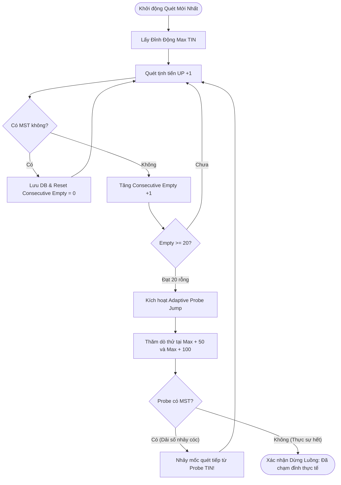
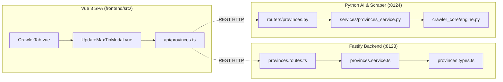

# Kế Hoạch Triển Khai: Brainstorm Giải Thuật Scan, Xử Lý Sự Cố & Bổ Sung Chuẩn Liên Kết `@related` Bằng ULID

> **Mã kế hoạch liên kết:** STT 94  
> **Mã ULID Phiên:** `01M4V1DM00N99K6P17B1V7X6M9`  
> **Thời gian lập:** 2026-10-13 23:35:00 UTC+7  
> **Phạm vi:** Toàn bộ Codebase (TypeScript, Vue 3, Python Crawler Core, C# .NET 10) & Hệ thống tài liệu `docs/`

---

## 1. Mục Tiêu Kỹ Thuật (Goal Description)

Yêu cầu gồm 2 trọng tâm chiến lược:
1. **Brainstorm & Đánh Giá Toàn Diện Các Giải Thuật Scan:**
   - Rà soát 5 giải thuật scan hiện có (`newest`, `bidirectional`, `gap_fill`, `gap_fill_500`, `edges`).
   - Mổ xẻ các vấn đề phát sinh thực tế khi vận hành (False stop khi gặp dải số thưa, WAF F5 rate limits & circuit breaking, GDT replication lag, session timeout).
   - Đề xuất các cải tiến giải thuật thế hệ mới (Adaptive Dynamic Probe, Predictive Heuristic Jump, Smart Skip In-Memory Cache).
2. **Xây Dựng Mạng Lưới Quan Hệ Bất Biến `@related` Bằng ULID:**
   - Toàn bộ 136 tệp mã nguồn đã được cấp mã định danh `@id <ULID>`.
   - Bổ sung siêu dữ liệu liên kết quan hệ `@related <ULID_1>, <ULID_2>` vào dòng comment tiếp theo trên đầu mỗi tệp mã nguồn.
   - Xây dựng **Code Dependency Graph** bất biến kết nối hai chiều giữa Frontend $\leftrightarrow$ Backend TypeScript Gateway $\leftrightarrow$ Python Worker $\leftrightarrow$ C# .NET 10 WebView2.
   - Nâng cấp bộ kiểm toán tự động [`scripts/audit_code_graph.py`](file:///c:/tracuuhoadon.gdt.gov.vn/scripts/audit_code_graph.py) để xác thực tính toàn vẹn (0 broken links) và kết xuất sơ đồ phụ thuộc vào [`docs/CODE_DEPENDENCY_GRAPH - <ULID>.md`](file:///c:/tracuuhoadon.gdt.gov.vn/docs/).
   - **Tuân thủ tuyệt đối [`GEMINI.md`](file:///c:/tracuuhoadon.gdt.gov.vn/GEMINI.md):** Đảm bảo 100% tệp sau khi thêm `@related` vẫn nằm dưới ngưỡng $\le 180$ dòng lý tưởng (hard cap 200 dòng).

---

## 2. Brainstorm & Đánh Giá Các Giải Thuật Scan

### 2.1. Ma Trận Đánh Giá 5 Giải Thuật Hiện Có

| Giải Thuật Scan | File Hiện Thực | Điểm Mạnh | Vấn Đề Phát Sinh (Pain Points) | Giải Pháp Cải Tiến Đề Xuất |
|:---|:---|:---|:---|:---|
| **1. Quét Mới Nhất (`newest` / Đỉnh Động)** | [`crawler_core/engine.py`](file:///c:/tracuuhoadon.gdt.gov.vn/crawler_core/engine.py#L158-L167) | • Tốc độ cao, chỉ quét phần ngọn<br>• Đón đầu doanh nghiệp mới thành lập | • **False Stop khi dải số thưa:** Gặp 20 số rỗng liên tiếp là dừng hẳn, trong khi cơ quan thuế có thể nhảy cóc 30-50 số.<br>• Kẹt mốc nếu DB chưa có đỉnh mới. | **Adaptive Dynamic Probe:** Khi gặp 20 rỗng, chưa dừng vội mà "nhảy dò đường" (probe jump) thử tại $+50, +100$. Nếu probe có MST thì tiếp tục quét; nếu probe cũng rỗng mới xác nhận dừng. |
| **2. Quét 2 Chiều Song Song (`bidirectional`)** | [`crawler_core/engine.py`](file:///c:/tracuuhoadon.gdt.gov.vn/crawler_core/engine.py#L174-L183) | • Vét cạn toàn diện cả tiến (+) và lùi (-)<br>• Tối ưu cho khởi động ban đầu | • Tốn gấp đôi request lên WAF F5.<br>• Dễ gây nghẽn hàng đợi nếu chạy nhiều tỉnh cùng lúc. | **Throttled Bidirectional:** Ưu tiên 80% quota request cho chiều tăng (`UP`) và 20% cho chiều giảm (`DOWN`). |
| **3. Quét Bù Bố Cáo (`gap_fill`)** | [`crawler_core/gap_filler.py`](file:///c:/tracuuhoadon.gdt.gov.vn/crawler_core/gap_filler.py#L31-L54) | • 100% mục tiêu là MST có thật<br>• Zero request rỗng vô ích | • **Replication Lag:** ĐKKD công bố trước GDT 1-3 ngày. Quét ngay sẽ bị miss.<br>• Phải retry nhiều lần. | **Smart Backoff:** Phân loại theo ngày công bố `pub_time`. Các mã mới dưới 24h đặt lịch retry sau 6h, 12h, 24h thay vì quét dồn dập. |
| **4. Quét Vá Lỗ Hổng 500 (`gap_fill_500`)** | [`crawler_core/gap_filler.py`](file:///c:/tracuuhoadon.gdt.gov.vn/crawler_core/gap_filler.py#L79-L144) | • Tự động vá các mã bị rớt do WAF block trong quá khứ<br>• Dùng `tin = ANY(%s)` cực nhanh | • Chạy lâu nếu dải số cũ có khoảng trống lớn.<br>• Dễ hiểu nhầm giữa "MST có trong DB" và "MST mới tìm thấy". | **Chế độ kép (Dual Mode):** Tiếp tục duy trì `reset_on_existing` cho quét sâu và `reset_on_new_found` cho quét kiểm toán nhanh. |
| **5. Quét Mở Rộng Biên (`edges`)** | [`crawler_core/engine.py`](file:///c:/tracuuhoadon.gdt.gov.vn/crawler_core/engine.py#L175-L182) | • Tự động lấy Min/Max DB làm điểm xuất phát | • Tương tự `bidirectional` nhưng tự động hóa mốc biên. | Duy trì ổn định. |

---

### 2.2. Sơ Đồ Thuật Toán Cải Tiến "Adaptive Dynamic Probe" (Khắc phục False Stop)



---

## 3. Thiết Kế Chuẩn Siêu Dữ Liệu `@related` Bằng ULID

### 3.1. Cú Pháp Chuẩn Hóa Theo Ngôn Ngữ
Mỗi tệp mã nguồn sẽ có cấu trúc Header 2 dòng:
- **Dòng 1:** Mã định danh bất biến của chính tệp: `@id <ULID_GỐC>`
- **Dòng 2:** Danh sách các mã định danh bất biến của các tệp có mối quan hệ phụ thuộc chặt chẽ: `@related <ULID_1>, <ULID_2>, ...`

```typescript
// @id 01M4V0HMKMKJ8KJM7W9Y8ZC1AW
// @related 01M4V0HMKNWS255D6X91RPS6R3, 01M4V0HMKPPP2QZ57VFX12A48P
```

```python
# @id 01M4V0HMPG69WC6HQYVZNJYVRT
# @related 01M4V15VQ2E8ZG0MTQ3H81VZGQ, 01M4V0HMQ2XD03NEEV125TBK52
```

```vue
<!-- @id 01M4V18JXRGFZS2AGBE3VJD8SP -->
<!-- @related 01M4V185C93JJXXTBKCA98G9KJ, 01M4V0HMMYPS07J4VMVA1PVV7Q -->
```

```csharp
// @id 01M4TZTRA1H79B5QWVJ4KZNV9G
// @related 01M4V0HMN7FE4FE1E8F43DFEAA, 01M4V0HMNVM4S634MN7VYTNK44
```

---

### 3.2. Ma Trận Phân Cụm Quan Hệ Codebase (6 Cụm Tính Năng)



---

## 4. Đề Xuất Thay Đổi Chi Tiết (Proposed Changes)

### 4.1. Bộ Công Cụ Quét & Gắn Tự Động `@related`

#### [NEW] [`scripts/apply_code_related.py`](file:///c:/tracuuhoadon.gdt.gov.vn/scripts/apply_code_related.py) (< 160 dòng)
- Tự động phân tích cây phụ thuộc thực tế từ các câu lệnh `import` trong TypeScript, Python, Vue SFC và C#.
- Ánh xạ đường dẫn import tới file đích $\rightarrow$ lấy `@id` của file đích $\rightarrow$ tạo dòng comment `@related <ULID_1>, <ULID_2>`.
- **Kiểm soát dòng code nghiêm ngặt:** Nếu chèn thêm 1 dòng làm file vượt quá 180 dòng, script tự động loại bỏ dòng trống thừa gần nhất để đưa file về $\le 180$ dòng!

#### [NEW] [`scripts/audit_code_graph.py`](file:///c:/tracuuhoadon.gdt.gov.vn/scripts/audit_code_graph.py) (< 160 dòng)
- Kiểm toán toàn diện:
  1. 100% file có `@id` hợp lệ.
  2. 100% các mã trong `@related` trỏ tới file có thật (0 broken links / orphan references).
  3. Kết xuất file tài liệu đồ thị phụ thuộc [`docs/CODE_DEPENDENCY_GRAPH - <ULID>.md`](file:///c:/tracuuhoadon.gdt.gov.vn/docs/) kèm Mermaid Diagram.

---

### 4.2. Cải Tiến Giải Thuật Scan Trong Crawler Core

#### [MODIFY] [`crawler_core/engine.py`](file:///c:/tracuuhoadon.gdt.gov.vn/crawler_core/engine.py)
- Thêm cơ chế **Adaptive Dynamic Probe** khi `consecutive_empty >= effective_gap` trong chế độ `newest`:
  Thăm dò nhanh 2 điểm probe tại $+50$ và $+100$ để chống hiện tượng False Stop do dải số thưa của cơ quan thuế.
- Giữ nguyên số dòng code $\le 180$ dòng.

---

## 5. Kế Hoạch Xác Thực & Kiểm Thử (Verification Plan)

### 5.1. Automated Tests
1. **Kiểm tra giới hạn dòng code (`npm run check:lines`):**
   Đảm bảo 100% file TypeScript $\le 180$ dòng lý tưởng.
2. **Kiểm tra đồ thị phụ thuộc (`python scripts/audit_code_graph.py`):**
   Xác thực 136/136 file code có quan hệ `@related` hợp lệ, 0 broken links.
3. **Kiểm tra hồi quy Backend (`python test_modular.py`):**
   Đảm bảo 17 endpoints API và engine dừng luồng hoạt động chuẩn xác 100%.
4. **Biên dịch Frontend Vue 3 Vite (`npm --prefix frontend run build`):**
   Xác thực không có lỗi TypeScript hay Vite bundling.
5. **Biên dịch C# .NET 10:**
   `dotnet build service_gui_csharp/GDTTaxCrawlerManager.csproj -c Release`.
6. **Kiểm toán tổng thể ULID (`python scripts/audit_ulid.py`):**
   Đảm bảo 0 collisions.

---

## 6. Quy Chuẩn Lưu Trữ Audit Logs & Topic Documentation

- Bản kế hoạch này được lưu trữ thành STT 94 trong [`docs/logs/INDEX.md`](file:///c:/tracuuhoadon.gdt.gov.vn/docs/logs/INDEX.md).
- Kết quả nghiệm thu sẽ được lưu vào STT 95 (`docs/logs/95_<timestamp>_walkthrough.md`).
- Bổ sung Topic kỹ thuật mới: `docs/topics/topic-16-adaptive-scan-and-ulid-code-graph - <ULID>.md` và cập nhật vào [`docs/TOPICS.md`](file:///c:/tracuuhoadon.gdt.gov.vn/docs/TOPICS.md).
