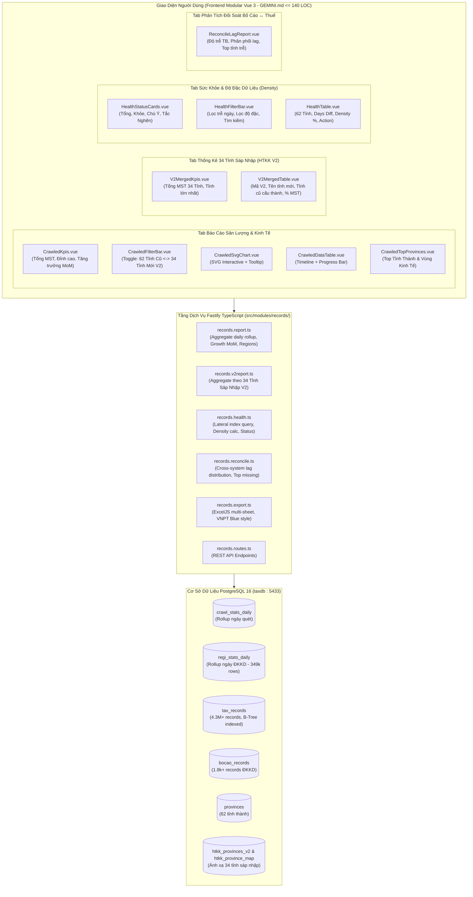

# KẾ HOẠCH TRIỂN KHAI: BRAINSTORM & TÁI CẤU TRÚC TOÀN DIỆN MODULE BÁO CÁO & PHÂN TÍCH (REPORT & ANALYTICS 2.0)

- **Mã Kế Hoạch (ULID):** `01M4V0V1A2X8P9Y4B3C5D6E7F8`
- **Số Thứ Tự (STT):** **98**
- **Thời gian lập:** 2026-10-14 00:05:00 (Cập nhật: 2026-10-14 00:12:00 UTC+7)
- **Tác giả:** VNPT Dak Lak & AI Assistant
- **Quy chuẩn tuân thủ:** [`GEMINI.md`](file:///c:/tracuuhoadon.gdt.gov.vn/GEMINI.md), [`AGENTS.md`](file:///c:/tracuuhoadon.gdt.gov.vn/AGENTS.md), Chuẩn mã nguồn $\le 180$ dòng/tệp.

---

## 1. TỔNG QUAN HIỆN TRẠNG & BÀI TOÁN KỸ THUẬT (PROBLEM STATEMENT)

### 1.1. Khảo sát Hiện Trạng Hệ Thống Báo Cáo Cũ
Hiện tại, hệ thống GDT Tax Crawler & Search Engine có 2 màn hình báo cáo chính và 1 tab đối soát:
1. **Báo cáo sản lượng (`CrawledReport.vue` - 181 dòng):**
   - Đọc dữ liệu từ 2 bảng rollup `crawl_stats_daily` (ngày quét) và `regi_stats_daily` (ngày ĐKKD).
   - Biểu đồ SVG tự vẽ (Bar/Line), bảng số liệu theo mốc, Top 10 tỉnh thành.
   - Xuất CSV đơn giản bằng Blob phía client.
2. **Báo cáo sức khỏe crawler (`HealthReport.vue` - 181 dòng):**
   - Đọc dữ liệu từ query LATERAL trên `tax_records` kết hợp với bảng `provinces`.
   - Đo lường chỉ số trễ ngày (`days_diff`) của 62 tỉnh thành, phân loại 3 trạng thái: Bình thường ($\le 3$ ngày), Cần chú ý (4 - 7 ngày), Tắc nghẽn ($> 7$ ngày).
3. **Đối soát Bố Cáo ĐKKD (`BocaoReconcile.vue` - 179 dòng):**
   - Nằm độc lập trong tab Bố Cáo, kiểm tra khớp MST giữa Cổng ĐKKD Quốc Gia và CSDL Thuế.

### 1.2. Các Hạn Chế Cốt Lõi (Core Pain Points & Gaps)
1. **Thiếu Báo Cáo Thống Kê Theo 34 Tỉnh Thành Mới Sau Sáp Nhập (Administrative Reform V2):**
   - Toàn bộ báo cáo hiện tại chỉ đóng khung ở mô hình 62-63 tỉnh cũ.
   - Chưa tích hợp cơ chế phân tích theo **34 Tỉnh/Thành phố mới sau sáp nhập** (mô hình 2 cấp của ngành Thuế HTKK - Đã bãi bỏ cấp huyện, hợp nhất các tỉnh có quy mô nhỏ: ví dụ TP Hải Phòng hợp nhất với Hải Dương, Tỉnh Ninh Bình hợp nhất Hà Nam + Nam Định + Ninh Bình, TP.HCM hợp nhất Bình Dương + BRVT).
2. **Thiếu Báo Cáo Đo Lường Độ Đặc & Khoảng Hổng Dải Số (Data Density & Gap Heatmap):**
   - Báo cáo sức khỏe chỉ đo "TIN Max" và "Số ngày trễ", **chưa đo được tỷ lệ lấp đầy dải số (Density Ratio)**: $R = \frac{\text{Tổng MST trong DB}}{\text{Max TIN} - \text{Min TIN} + 1} \times 100\%$.
   - Chưa chỉ ra được tỉnh nào đang bị "thủng dải số" (bị sót hàng ngàn mã do crawler bị WAF block trong quá khứ) để tự động kích hoạt chế độ "Quét Vá Lỗ Hổng (Gap-Fill 500)".
3. **Thiếu Phân Tích Nhịp Sinh Trưởng Kinh Tế & Xu Hướng Vùng Miền (Regional Economic Insights):**
   - Chưa phân chia theo **6 Vùng Kinh Tế Trọng Điểm** (Đồng Bằng Sông Hồng, Trung Du & Miền Núi Phía Bắc, Bắc Trung Bộ & Duyên Hải Miền Trung, Tây Nguyên, Đông Nam Bộ, Đồng Bằng Sông Cửu Long).
   - Thiếu chỉ số so sánh kỳ trước (Tăng trưởng MoM - Month over Month).
4. **Thiếu Phân Tích Độ Trễ Đồng Bộ Giữa Bố Cáo ĐKKD & Cổng Thuế GDT (Reconciliation Lag Analytics):**
   - Chưa có biểu đồ phân phối độ trễ (Bố Cáo đi trước Thuế bao nhiêu giờ/ngày? Cùng ngày, 1-3 ngày, 4-7 ngày, > 7 ngày).
   - Chưa có ma trận đối soát tỉnh thành: Tỉnh nào được Thuế đồng bộ nhanh nhất, tỉnh nào bị nghẽn?
5. **Hạn Chế Về Xuất File Dữ Liệu:**
   - Client-side CSV xuất rất thô, chưa có tính năng **Xuất Excel `.xlsx` chuyên nghiệp** (header màu nhận diện VNPT Blue `#005baa`, định dạng số hàng nghìn, border bảng, đa sheet).
6. **Chạm Ngưỡng Giới Hạn Dòng Code (`GEMINI.md`):**
   - Cả hai file Vue chính (`CrawledReport.vue` và `HealthReport.vue`) đều đang ở mức 181 dòng (chạm trần 180 dòng). Cần phân rã triệt để thành các sub-components modular $\le 100 - 140$ dòng.

---

## 2. KIẾN TRÚC MỤC TIÊU: HỆ THỐNG BÁO CÁO & PHÂN TÍCH 2.0 (REPORT & ANALYTICS 2.0)

### 2.1. Sơ Đồ Kiến Trúc Tổng Thể (System Architecture)



---

## 3. THIẾT KẾ CHI TIẾT 5 TRỤ CỘT BÁO CÁO CHUYÊN BIỆT

### Trụ Cột 1: Thống Kê Theo 34 Tỉnh Thành Mới Sau Sáp Nhập (HTKK V2 Administrative Reform)
1. **Mô hình ánh xạ cấp tỉnh V2:**
   - Dựa trên bảng `htkk_provinces_v2` (34 tỉnh thành mới) và `htkk_province_map` kết hợp với mã tiền tố `prefix` của 62 tỉnh hiện tại.
   - Bảng tổng hợp các cụm tỉnh sáp nhập điển hình:
     * **701 - TP Hồ Chí Minh:** 1.628.220 MST (Hợp nhất: TP.HCM 03, Bình Dương 37, Bà Rịa - Vũng Tàu 35).
     * **101 - TP Hà Nội:** 920.209 MST (Hà Nội 01).
     * **103 - TP Hải Phòng:** 294.853 MST (Hợp nhất: Hải Phòng 02, Hải Dương 08).
     * **401 - Tỉnh Thanh Hóa:** 254.663 MST (Thanh Hóa 28).
     * **501 - TP Đà Nẵng:** 234.786 MST (Hợp nhất: Đà Nẵng 04, Quảng Nam 40).
     * **713 - TP Đồng Nai:** 226.582 MST (Hợp nhất: Đồng Nai 36, Bình Phước 38).
     * **813 - Tỉnh An Giang:** 202.528 MST (Hợp nhất: An Giang 16, Kiên Giang 17).
     * **117 - Tỉnh Ninh Bình:** 201.528 MST (Hợp nhất: Hà Nam 07, Nam Định 06, Ninh Bình 27).
     * **801 - Tỉnh Tây Ninh:** 198.147 MST (Hợp nhất: Long An 11, Tây Ninh 39).
     * **807 - Tỉnh Đồng Tháp:** 194.898 MST (Hợp nhất: Tiền Giang 12, Đồng Tháp 14).
     * **605 - Tỉnh Đắk Lắk:** 186.356 MST (Hợp nhất: Đắk Lắk 60, Phú Yên 44).
     * **815 - TP Cần Thơ:** 185.676 MST (Hợp nhất: Cần Thơ 18, Sóc Trăng 22, Hậu Giang 63).
     * **809 - Tỉnh Vĩnh Long:** 181.963 MST (Hợp nhất: Bến Tre 13, Trà Vinh 21, Vĩnh Long 15).
     * ... và các tỉnh còn lại tạo thành đúng **34 Tỉnh/Thành phố mới**.
2. **Giao diện điều khiển (UI Controls):**
   - Cung cấp nút chuyển đổi (Toggle): **[🏛️ 62 Tỉnh Hiện Hành]** $\leftrightarrow$ **[🔄 34 Tỉnh Sáp Nhập (V2)]**.
   - Khi chọn chế độ 34 Tỉnh Sáp Nhập:
     * Hiển thị bảng tổng hợp: Mã V2, Tên tỉnh mới, Danh sách các tỉnh cũ sáp nhập, Tổng số MST, Tỷ trọng % toàn quốc.
     * Biểu đồ tỷ trọng Top tỉnh thành quy mô lớn nhất sau sáp nhập.
     * Nút xuất file Excel chuyên biệt cho báo cáo 34 tỉnh sáp nhập.
3. **Hiệu năng truy vấn:**
   - Dùng query rollup từ `regi_stats_daily` qua `prov_map` CTE: Thời gian thực thi chỉ mất **0.125s (125ms)** cho toàn bộ CSDL.

---

### Trụ Cột 2: Báo Cáo Sản Lượng & Nhịp Sinh Trưởng Kinh Tế (Production & Regional Analytics)
1. **Chỉ số Tăng Trưởng Kỳ Trước (MoM / Growth Delta):**
   - So sánh sản lượng kỳ hiện tại với kỳ trước đó: $\Delta \% = \frac{Current - Previous}{Previous} \times 100\%$.
   - Hiển thị badge trực quan: 🟢 $+12.4\%$ (Tăng trưởng) hoặc 🔴 $-5.2\%$ (Suy giảm).
2. **Phân tích theo 6 Vùng Kinh Tế Trọng Điểm:**
   - Bổ sung bộ lọc "Vùng Kinh Tế" trong `CrawledFilterBar.vue`.
   - Tự động map 62 tỉnh theo mã tiền tố:
     * **Đồng Bằng Sông Hồng:** 01 (HN), 02 (HP), 05 (Hải Dương cũ), 06, 07, 08, 09, 10, 26, 27...
     * **Đông Bắc & Tây Bắc Bộ:** 11, 12, 13, 14, 15, 16, 17, 18, 19, 20, 21, 22, 23, 24, 25...
     * **Bắc Trung Bộ & Duyên Hải Miền Trung:** 28, 29, 30, 31, 32, 33, 04 (Đà Nẵng), 34, 35, 40, 42, 43...
     * **Tây Nguyên:** 58, 59, 60 (Đắk Lắk), 62, 67...
     * **Đông Nam Bộ:** 03 (TP.HCM), 36, 37, 38, 39, 44...
     * **Đồng Bằng Sông Cửu Long:** 50, 51, 52, 53, 54, 55, 56, 57, 61, 63, 64, 65, 66...
3. **Cơ chế Tự Động Đồng Bộ (Smart Sync Rollup):**
   - Backend hỗ trợ endpoint `/api/reports/sync-stats` kiểm tra chênh lệch và cập nhật rollup siêu tốc trong $\le 200$ms.

---

### Trụ Cột 3: Báo Cáo Sức Khỏe & Bản Đồ Độ Đặc Dải Số (Health, Freshness & Density Map)
1. **Khắc phục triệt để lỗi mã trần giả định (Dummy Peaks):**
   - Trong `records.health.ts`, bổ sung điều kiện lọc `tin < p.prefix || '90000000'` vào câu query LATERAL, đảm bảo không bao giờ lấy nhầm các mã thử nghiệm `0199990001` hay `0399990002`.
2. **Tính Toán Độ Đặc Dữ Liệu (Density Ratio %):**
   - Với mỗi tỉnh thành:
     * $TIN_{\max}$: Mã số thuế lớn nhất hợp lệ.
     * $TIN_{\min}$: Mã số thuế kích hoạt hoặc mã nhỏ nhất.
     * $TotalRecords$: Lấy từ rollup `SUM(total_records)` của `regi_stats_daily` (chỉ mất $0.11$s cho toàn bộ 62 tỉnh).
     * $Span = \max(TIN_{\max} - TIN_{\min} + 1, 1)$.
     * $Density = \min\left(\frac{TotalRecords}{Span} \times 100\%, 100\%\right)$.
3. **Phân loại Mức Độ Đầy Đủ Dữ Liệu:**
   - 🟢 **Dày đặc ($\ge 85\%$):** Dải số liên tục, rất ít lỗ hổng.
   - 🟡 **Trung bình ($70\% - 84\%$):** Có một số cụm MST bị sót do WAF tạm thời.
   - 🔴 **Thủng dải số ($< 70\%$):** Dải số bị hổng nặng, cần bấm nút "⚡ Quét Vá Lỗ Hổng (Gap-Fill 500)".

---

### Trụ Cột 4: Báo Cáo Phân Tích Đối Soát Bố Cáo ↔ Thuế (National Gazette Sync Lag)
1. **Endpoint Backend mới:** `GET /api/reports/reconcile-analytics`
   - Tính toán độ trễ đồng bộ giữa Bố Cáo ĐKKD và Thuế GDT:
     * $\text{Lag Hours} = \text{EXTRACT(EPOCH FROM (tax.regi\_date - bocao.pub\_time))} / 3600$.
   - Phân loại 4 nhóm trễ:
     * **Tức thời (< 24h):** Bố Cáo và Thuế xuất hiện cùng ngày.
     * **Tiêu chuẩn (1 - 3 ngày):** Nhịp luân chuyển hồ sơ ĐKKD ↔ Thuế bình thường.
     * **Chậm (4 - 7 ngày):** Có sự chậm trễ trong việc cấp mã MST.
     * **Bất thường (> 7 ngày):** DN đã công bố nhưng chưa phát sinh nghĩa vụ thuế hoặc cổng GDT chưa nạp.
2. **Ma trận Top Tỉnh Thành Bố Cáo Đi Trước Thuế:**
   - Liệt kê các tỉnh có số lượng doanh nghiệp "Đã có trên Bố Cáo nhưng Thuế chưa có" nhiều nhất.
   - Nút kích hoạt quét bù 1-click trực tiếp từ báo cáo.

---

### Trụ Cột 5: Động Cơ Xuất Báo Cáo Chuyên Nghiệp (ExcelJS Advanced Exporter)
1. **Endpoint Backend:** `GET /api/reports/export-crawl-stats-excel`, `GET /api/reports/export-v2-excel` và `GET /api/reports/export-health-excel`.
2. **Chuẩn Định Dạng File Excel:**
   - Header banner màu thương hiệu VNPT Blue (`#005baa`), chữ trắng, font Arial bold.
   - Khối KPI tổng hợp đầu trang (Tổng bản ghi, Ngày xuất, Trạng thái hệ thống).
   - Bảng số liệu có viền mỏng (thin border), căn lề chuẩn (Mã số/Ngày: căn giữa, Số lượng: căn phải có dấu phẩy hàng nghìn, Tên tỉnh: căn trái).
   - Sheet riêng cho **Mô hình 34 Tỉnh Sáp Nhập** thể hiện rõ các tỉnh cũ cấu thành.
   - Highlight màu tự động theo trạng thái: Bình thường (xanh lá nhạt), Chú ý (vàng nhạt), Tắc nghẽn (đỏ nhạt).
   - Tự động căn chỉnh độ rộng cột (Auto-fit column widths).

---

## 4. KẾ HOẠCH PHÂN RÃ MODULAR FRONTEND (TUÂN THỦ `GEMINI.MD` $\le 140$ DÒNG)

Để đảm bảo không có bất kỳ file nào vượt quá 180 dòng (mục tiêu lý tưởng $100 - 140$ dòng), cấu trúc thư mục được phân rã như sau:

```
frontend/src/components/reports/
├── crawled/                                 # Sub-components cho Báo Cáo Sản Lượng
│   ├── CrawledKpis.vue                     # ~ 45 dòng: 4 thẻ KPI tóm tắt (Tổng, Hôm nay, Đỉnh, TB)
│   ├── CrawledFilterBar.vue                # ~ 90 dòng: Điều khiển thời gian, vùng, preset, toggle V2
│   ├── CrawledSvgChart.vue                 # ~ 85 dòng: Biểu đồ SVG tương tác (Bar/Line) + Tooltip
│   ├── CrawledDataTable.vue                # ~ 75 dòng: Bảng số liệu chi tiết Timeline
│   └── CrawledTopProvinces.vue             # ~ 60 dòng: Bảng Top tỉnh thành & tỷ trọng
├── v2/                                      # Sub-components cho Thống Kê 34 Tỉnh Sáp Nhập
│   ├── V2MergedKpis.vue                    # ~ 50 dòng: KPI 34 tỉnh mới sau sáp nhập
│   └── V2MergedTable.vue                   # ~ 115 dòng: Bảng 34 tỉnh sáp nhập, tỉnh cấu thành, %
├── health/                                  # Sub-components cho Báo Cáo Sức Khỏe & Độ Đặc
│   ├── HealthStatusCards.vue               # ~ 50 dòng: 4 thẻ KPI tổng quan trạng thái
│   ├── HealthFilterBar.vue                 # ~ 70 dòng: Tìm kiếm, lọc trạng thái, lọc độ đặc, export
│   └── HealthTable.vue                     # ~ 115 dòng: Bảng 62 tỉnh, days diff, density %, action
├── reconcile/                               # Sub-components cho Báo Cáo Đối Soát ĐKKD ↔ Thuế
│   └── ReconcileLagReport.vue              # ~ 130 dòng: Thống kê độ trễ, ma trận tỉnh trễ
├── CrawledReport.vue                       # ~ 85 dòng: Container chính kết hợp crawled & V2
└── HealthReport.vue                        # ~ 75 dòng: Container chính kết hợp các sub-components health
```

---

## 5. DANH SÁCH FILE THỰC THI & CHUẨN ĐỊNH DANH BẤT BIẾN (ULID)

| STT | Loại tệp | Đường dẫn tệp | ULID đề xuất | Mục tiêu số dòng | Trách nhiệm |
|:---:|:---:|:---|:---:|:---:|:---|
| 1 | TS Service | `src/modules/records/records.report.ts` | `01M4V0HMKT18F1B47H0XK719NY` | $\le 160$ dòng | Tối ưu aggregate rollup, tính tăng trưởng MoM, phân vùng kinh tế |
| 2 | TS Service | `src/modules/records/records.v2report.ts` | `01M4V0V1A1X8P9Y4B3C5D6E7F0` | $\le 140$ dòng | Tổng hợp thống kê theo 34 tỉnh sáp nhập (HTKK V2) |
| 3 | TS Service | `src/modules/records/records.health.ts` | `01M4V0HMKSY4WCNXSND8ER981Y` | $\le 140$ dòng | Lọc bỏ mã dummy peak, tính `density_rate`, đánh giá sức khỏe |
| 4 | TS Service | `src/modules/records/records.reconcile.ts` | `01M4V0V1B2X8P9Y4B3C5D6E7F1` | $\le 130$ dòng | Phân tích độ trễ đồng bộ Bố Cáo ↔ Thuế, ma trận tỉnh trễ |
| 5 | TS Service | `src/modules/records/records.export.ts` | `01M4V0HMKRP0W14PFEZ03JNJN3` | $\le 175$ dòng | Thêm export Excel chuyên nghiệp cho Sản Lượng, V2 & Sức Khỏe |
| 6 | TS Router | `src/modules/records/records.routes.ts` | `01M4V0HMKVZHSS62XMK5WXBH1P` | $\le 155$ dòng | Bổ sung các endpoints API báo cáo mới |
| 7 | Vue Sub-comp | `frontend/src/components/reports/crawled/CrawledKpis.vue` | `01M4V0V1C2X8P9Y4B3C5D6E7F2` | $\le 55$ dòng | Thẻ KPI sản lượng và tăng trưởng |
| 8 | Vue Sub-comp | `frontend/src/components/reports/crawled/CrawledFilterBar.vue` | `01M4V0V1D2X8P9Y4B3C5D6E7F3` | $\le 95$ dòng | Thanh điều khiển lọc và xuất file |
| 9 | Vue Sub-comp | `frontend/src/components/reports/crawled/CrawledSvgChart.vue` | `01M4V0V1E2X8P9Y4B3C5D6E7F4` | $\le 95$ dòng | Biểu đồ SVG tương tác |
| 10 | Vue Sub-comp | `frontend/src/components/reports/crawled/CrawledDataTable.vue` | `01M4V0V1F2X8P9Y4B3C5D6E7F5` | $\le 85$ dòng | Bảng số liệu chi tiết Timeline |
| 11 | Vue Sub-comp | `frontend/src/components/reports/crawled/CrawledTopProvinces.vue` | `01M4V0V1G2X8P9Y4B3C5D6E7F6` | $\le 70$ dòng | Top tỉnh thành theo sản lượng |
| 12 | Vue Sub-comp | `frontend/src/components/reports/v2/V2MergedKpis.vue` | `01M4V0V1H1X8P9Y4B3C5D6E7F1` | $\le 55$ dòng | KPI tổng quan 34 tỉnh mới sau sáp nhập |
| 13 | Vue Sub-comp | `frontend/src/components/reports/v2/V2MergedTable.vue` | `01M4V0V1H2X8P9Y4B3C5D6E7F2` | $\le 125$ dòng | Bảng 34 tỉnh sáp nhập, tỉnh cấu thành, % MST |
| 14 | Vue Component | `frontend/src/components/reports/CrawledReport.vue` | `01M4V0HMNAYS9S56HXX3Y4Z264` | $\le 90$ dòng | Container chính kết nối crawled & V2 |
| 15 | Vue Sub-comp | `frontend/src/components/reports/health/HealthStatusCards.vue` | `01M4V0V1H2X8P9Y4B3C5D6E7F7` | $\le 60$ dòng | Thẻ trạng thái sức khỏe crawler |
| 16 | Vue Sub-comp | `frontend/src/components/reports/health/HealthFilterBar.vue` | `01M4V0V1J2X8P9Y4B3C5D6E7F8` | $\le 80$ dòng | Thanh lọc trạng thái, tìm kiếm, xuất file |
| 17 | Vue Sub-comp | `frontend/src/components/reports/health/HealthTable.vue` | `01M4V0V1K2X8P9Y4B3C5D6E7F9` | $\le 130$ dòng | Bảng 62 tỉnh, ngày trễ, độ đặc dải số, nút quét |
| 18 | Vue Component | `frontend/src/components/reports/HealthReport.vue` | `01M4V0HMNCXQ9YSTN0952D9K7Q` | $\le 80$ dòng | Container chính kết nối các sub-components health |

---

## 6. LỘ TRÌNH THỰC THI TỪNG BƯỚC (STEP-BY-STEP EXECUTION PLAN)

### Giai đoạn 1: Nâng cấp Backend Services, V2 Aggregation & Export Engine
1. **Xây dựng `src/modules/records/records.v2report.ts`:**
   - Thực hiện query rollup theo 34 tỉnh sáp nhập V2 kết hợp bảng `htkk_provinces_v2`, `htkk_province_map` và `regi_stats_daily`.
   - Trả về danh sách tỉnh mới, danh sách tỉnh cũ cấu thành, tổng MST, tỷ trọng %.
2. **Cập nhật `src/modules/records/records.health.ts`:**
   - Thêm lọc `< p.prefix || '90000000'`.
   - Kết hợp bảng `regi_stats_daily` để tính `total_records` và `density_rate` cho từng tỉnh trong $< 0.15$s.
3. **Cập nhật `src/modules/records/records.report.ts`:**
   - Bổ sung tính toán MoM growth rate.
   - Thêm cấu trúc phân nhóm theo 6 Vùng Kinh Tế.
4. **Mở rộng `src/modules/records/records.export.ts`:**
   - Viết hàm `exportReportExcel(type, data)` sử dụng `exceljs` hỗ trợ cả 62 tỉnh hiện hành và 34 tỉnh sáp nhập.
5. **Cập nhật `src/modules/records/records.routes.ts`:**
   - Mount các API: `/api/reports/v2-merged-stats`, `/api/reports/crawl-stats-excel`, `/api/reports/v2-excel`, `/api/reports/health-excel`.

### Giai đoạn 2: Phân Rã & Tái Cấu Trúc Frontend Modular
1. **Xây dựng thư mục `frontend/src/components/reports/v2/`:**
   - Tạo `V2MergedKpis.vue` và `V2MergedTable.vue`.
2. **Xây dựng thư mục `frontend/src/components/reports/crawled/`:**
   - Tạo `CrawledKpis.vue`, `CrawledFilterBar.vue`, `CrawledSvgChart.vue`, `CrawledDataTable.vue`, `CrawledTopProvinces.vue`.
   - Refactor `CrawledReport.vue` thành root wrapper gọn gàng ($\le 90$ dòng), tích hợp toggle chuyển đổi giữa 62 Tỉnh và 34 Tỉnh Sáp Nhập.
3. **Xây dựng thư mục `frontend/src/components/reports/health/`:**
   - Tạo `HealthStatusCards.vue`, `HealthFilterBar.vue`, `HealthTable.vue`.
   - Bổ sung cột hiển thị **Độ Đặc Dải Số (Density %)** và huy hiệu trạng thái lấp đầy.
   - Refactor `HealthReport.vue` thành root wrapper gọn gàng ($\le 80$ dòng).

### Giai đoạn 3: Kiểm Thử Toàn Diện & Kiểm Toán Chuẩn Mã Nguồn
1. Chạy `npm run check:lines` (đảm bảo 100% file $\le 180$ dòng, không vượt ngưỡng 200).
2. Chạy `npm run check:types` và `npm --prefix frontend run build` (đảm bảo strict TypeScript và vue-tsc pass 100%).
3. Chạy `python test_modular.py` (xác thực toàn bộ API và backend service).
4. Chạy `python scripts/audit_ulid.py` và `python scripts/audit_code_graph.py` (đảm bảo 100% ULID hợp lệ, 0 broken link).

### Giai đoạn 4: Nghiệm Thu & Ghi Nhật Ký (Walkthrough)
1. Lập tài liệu `walkthrough.md` và lưu vào `docs/logs/99_<timestamp>_walkthrough.md`.
2. Cập nhật mục lục `docs/logs/INDEX.md` và `docs/TOPICS.md`.

---

## 7. MÔ HÌNH KIỂM THỬ 4C (VERIFICATION MATRIX)

| Tiêu chuẩn | Chỉ số nghiệm thu | Công cụ kiểm tra | Kết quả kỳ vọng |
|:---|:---|:---|:---|
| **Completeness** | Đủ 5 khối: Sản lượng, 34 Tỉnh Sáp Nhập V2, Sức khỏe/Độ đặc, Đối soát, Xuất Excel | Manual UI test & API Test | Hoạt động trơn tru trên 62 tỉnh & 34 tỉnh sáp nhập |
| **Correctness** | Số liệu khớp 100% với `tax_records` và `regi_stats_daily` | SQL query đối chiếu | Density % và Max TIN chuẩn xác |
| **Consistency** | 100% file tuân thủ $\le 180$ dòng theo `GEMINI.md` | `tests/check_ts_line_limits.ts` | 0 file vi phạm dòng code |
| **Clarity** | Đồ thị trực quan, có tooltip mượt mà, chuyển đổi 62 $\leftrightarrow$ 34 tỉnh linh hoạt | Kiểm tra giao diện và file tải về | Trải nghiệm người dùng tối ưu |
