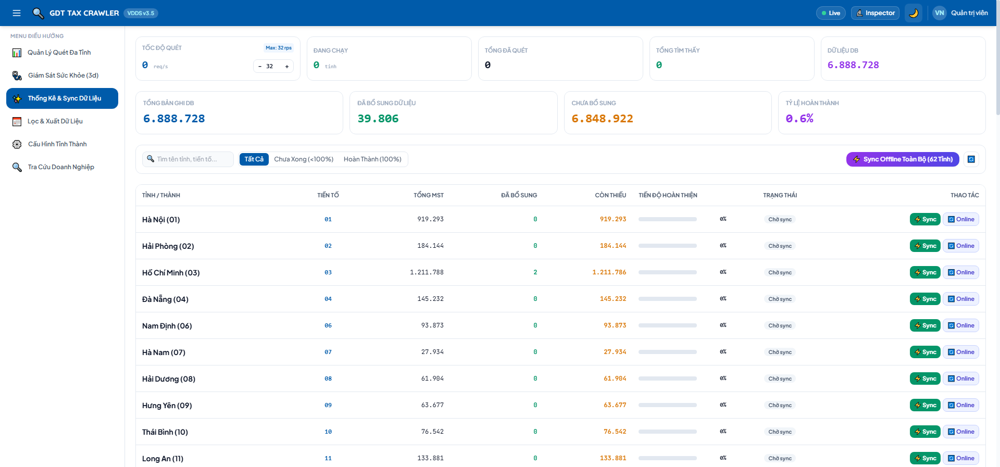
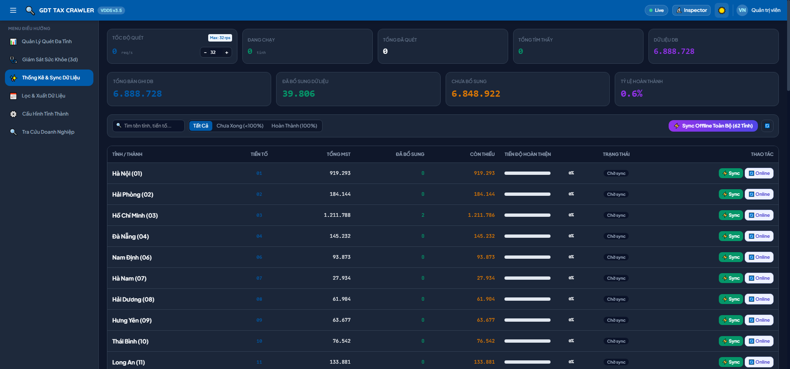
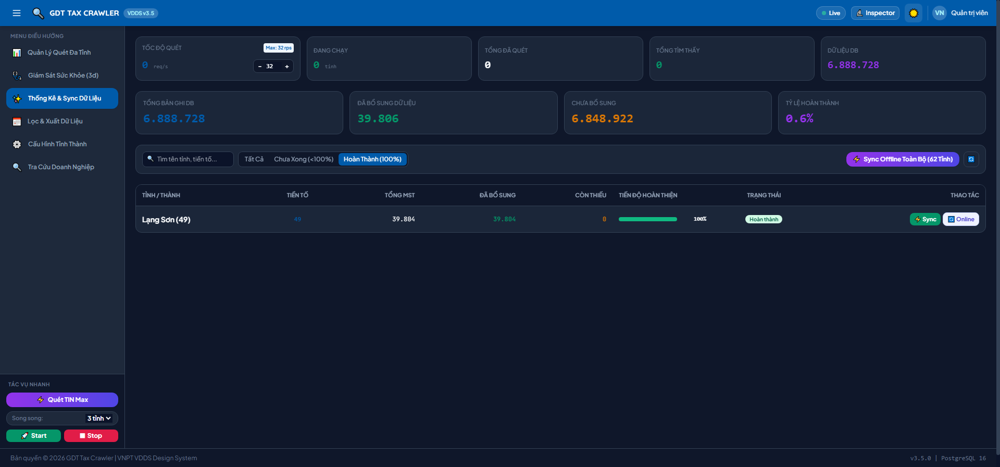
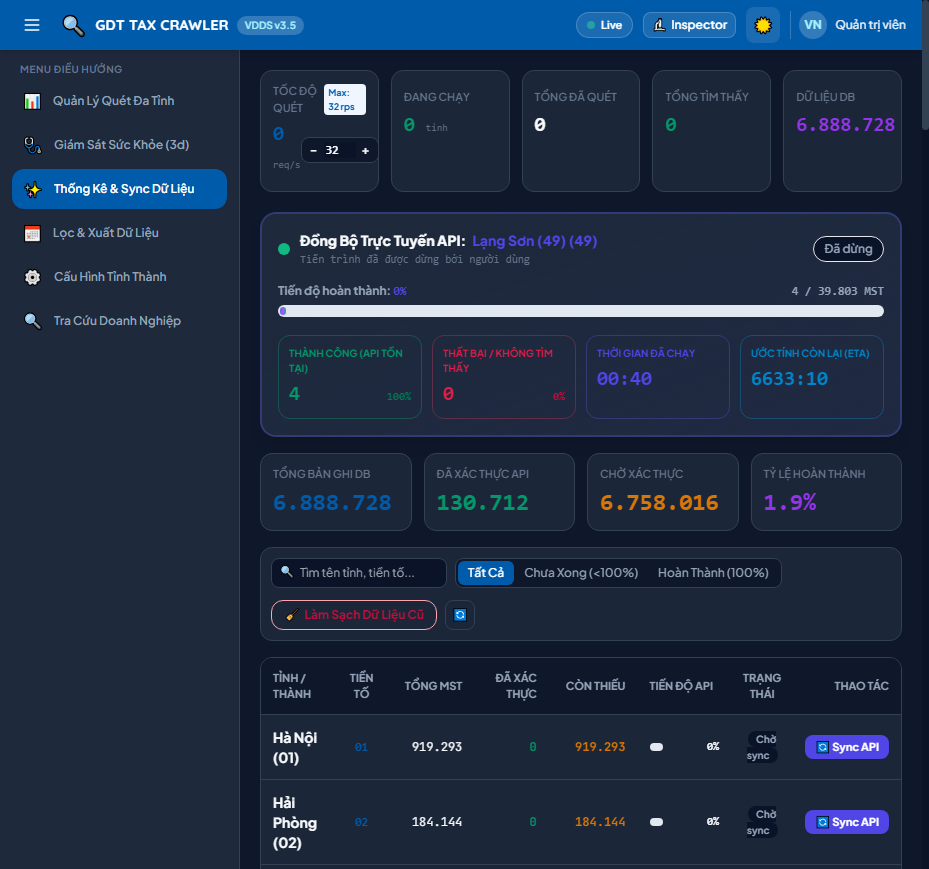
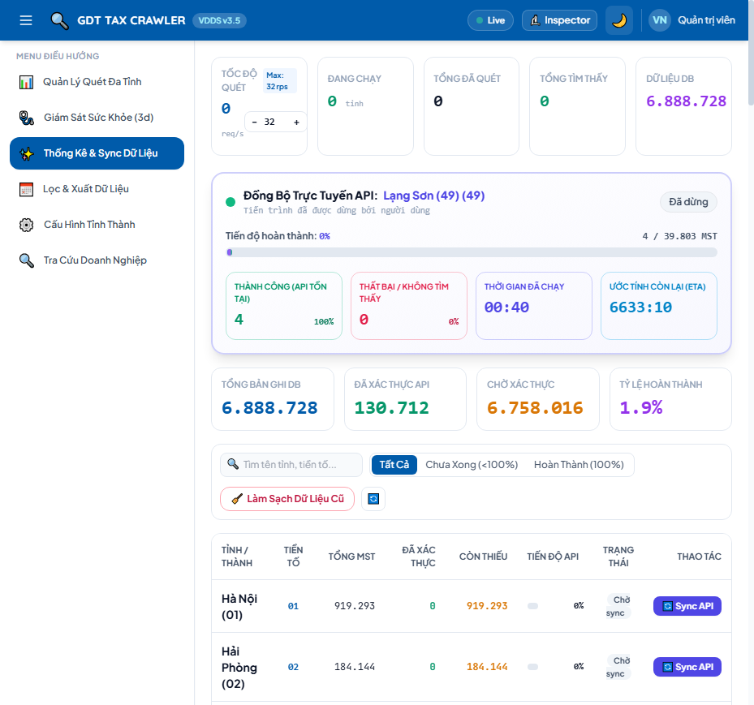

# Topic 03: Phân Tích Dữ Liệu API Xinvoice & Thiết Kế Module Bổ Sung Thuộc Tính Thuế (Enrichment Module)

**Ngày hoàn thành:** 20/09/2026  
**Trạng thái:** ✅ Đã hoàn thành & Nghiệm thu  
**Mục tiêu:** Phân tích giao thức và cấu trúc dữ liệu từ `https://xinvoice.vn/apis/tra-cuu-ma-so-thue/`, thiết kế giải pháp mở rộng dữ liệu cho hệ thống GDT Tax Crawler, bổ sung 3 thuộc tính quan trọng: `orgType` (Loại tổ chức), `address` (Địa chỉ chuẩn hóa), `taxDepartment` (Cơ quan thuế quản lý), và hỗ trợ cập nhật theo toàn tỉnh.

---

## 1. Phân Tích Dữ Liệu Từ Dịch Vụ API Xinvoice

Dịch vụ tra cứu MST của Xinvoice (`https://xinvoice.vn/apis/tra-cuu-ma-so-thue/`) được phát triển bởi Công ty TNHH Casso, phục vụ mục đích xuất hóa đơn điện tử tự động và chuẩn hóa thông tin doanh nghiệp/hộ kinh doanh tại Việt Nam.

### 1.1. Giao Thức & Endpoint Tra Cứu
- **Cơ bản (Đơn lẻ):** `GET https://api.xinvoice.vn/gdt-api/tax-payer/:taxCode`
- **Chi tiết (Nhiều chi nhánh / Đầy đủ):** `GET https://api.xinvoice.vn/gdt-api/tax-payer-records/:taxCode`
- **Headers:**
  - `Accept: application/json`
  - `client-id: <client-id>` (Tùy chọn cho tài khoản trả phí)
  - `api-key: <api-key>` (Tùy chọn cho tài khoản trả phí)

### 1.2. Thử Nghiệm Thực Tế & Định Dạng Dữ Liệu
Khi gửi yêu cầu qua cURL:
```bash
curl -s "https://api.xinvoice.vn/gdt-api/tax-payer/4900127704"
```
Dữ liệu JSON phản hồi (HTTP 200 OK):
```json
{
  "orgType": "Doanh nghiệp / Đơn vị sự nghiệp công lập",
  "taxID": "4900127704",
  "name": "Bùi Thị Giang",
  "address": "Chợ Mẹt., Xã Hữu Lũng, Lạng Sơn",
  "taxDepartment": "Thuế cơ sở 1 tỉnh Lạng Sơn",
  "status": "NNT ngừng HĐ nhưng chưa hoàn thành thủ tục chấm dứt hiệu lực MST",
  "updatedAt": "2025-11-07T23:56:53.000Z"
}
```

### 1.3. Bảng Đối Chiếu Thuộc Tính Với CSDL Hiện Có (`tax_records`)

| Thuộc Tính Xinvoice | Thuộc Tính GDT Gốc | Cột Mới Trong CSDL | Ý Nghĩa Kỹ Thuật |
|:---|:---|:---|:---|
| `orgType` | `dvsd` / `econ_name` (chưa phân loại) | `org_type TEXT` | Loại tổ chức: *Doanh nghiệp*, *Chi nhánh*, *Hộ kinh doanh cá thể* |
| `address` | `tran_addr` | `address TEXT` | Địa chỉ đăng ký kinh doanh đã được gọt giũa và chuẩn hóa |
| `taxDepartment` | `pay_taxo_name_blhd` / `pay_taxo_name` | `tax_department TEXT` | Cơ quan thuế quản lý trực tiếp |
| `status` | `status_name` | (Tái sử dụng `status_name`) | Trạng thái hoạt động của NNT |
| `updatedAt` | `scraped_at` | `enriched_at TIMESTAMP` | Dấu thời gian làm giàu dữ liệu gần nhất |

### 1.4. Đặc Tính Tốc Độ & Kiểm Soát Tần Suất (Rate Limiting)
- Header phản hồi thực tế từ Cloudflare:
  - `RateLimit: "10-in-30sec"; r=9; t=30`
  - `RateLimit-Policy: "10-in-30sec"; q=10; w=30`
- **Đánh giá:** Mỗi IP miễn phí được phép gửi tối đa 10 requests trong cửa sổ trượt 30 giây (~0.33 req/s). Nếu gửi dồn dập sẽ nhận mã lỗi `HTTP 429 Too Many Requests`.
- **Hệ quả kiến trúc:** Không thể quét vét cạn 10.000 – 100.000 MST trong 1 tỉnh chỉ bằng việc gọi API tuần tự (sẽ mất từ vài giờ đến cả ngày). Bắt buộc phải có **Chiến lược lai (Hybrid Enrichment Strategy)**.

---

## 2. Kiến Trúc Giải Pháp: Chiến Lược Bổ Sung Dữ Liệu Lai (Hybrid Enrichment)

Nhằm đáp ứng yêu cầu *"cập nhật bổ sung cho mã số thuế, cập nhật theo toàn tỉnh"* vừa có kết quả tức thì vừa có khả năng đồng bộ dữ liệu chuyên sâu:

```
                      ┌────────────────────────────────────────┐
                      │    Yêu Cầu Cập Nhật Bổ Sung Toàn Tỉnh  │
                      └──────────────────┬─────────────────────┘
                                         │
                 ┌───────────────────────┴───────────────────────┐
                 ▼                                               ▼
    [1. FAST-PATH OFFLINE INFERENCE]                [2. DEEP-SYNC ONLINE QUEUE]
    - Quét toàn bộ MST trong CSDL của tỉnh          - Đẩy danh sách MST vào hàng đợi nền
    - Suy luận `orgType` dựa trên độ dài TIN & text   - Token Bucket rate limiter (0.33 req/s)
    - Đồng bộ `address` từ `tran_addr`              - Gọi API Xinvoice cập nhật chính xác
    - Đồng bộ `taxDepartment` từ `pay_taxo_name`    - Ghi nhận `enriched_at`
    - Tốc độ: > 50.000 bản ghi / giây               - Chạy ngầm không ảnh hưởng hệ thống
```

### 2.1. Quy Tắc Suy Luận Ngoại Tuyến (Offline Inference Rules)
1. **Loại tổ chức (`org_type`):**
   - Nếu `LENGTH(tin) > 10` hoặc `tin LIKE '%-%'`: Gán là `"Chi nhánh"`.
   - Nếu `norm_name ILIKE 'HỘ KINH DOANH%'` hoặc `econ_name ILIKE '%hộ%'`: Gán là `"Hộ kinh doanh cá thể"`.
   - Các trường hợp còn lại: Gán là `"Doanh nghiệp / Đơn vị sự nghiệp công lập"`.
2. **Địa chỉ (`address`):**
   - Kế thừa và chuẩn hóa khoảng trắng từ `tran_addr`.
3. **Cơ quan thuế (`tax_department`):**
   - Kế thừa từ `COALESCE(pay_taxo_name_blhd, pay_taxo_name)`.

### 2.2. Đồng Bộ Trực Tuyến Chuyên Sâu (Online Deep-Sync)
- Khi người dùng xem chi tiết 1 MST trong Modal: Hệ thống gọi trực tiếp `GET /api/enrichment/:tin` để lấy dữ liệu mới nhất từ Xinvoice API và cập nhật ngay vào CSDL.
- Khi người dùng chọn "Đồng bộ API Xinvoice toàn tỉnh": Tiến trình nền điều tiết nhịp độ 0.33 req/s (hoặc theo giới hạn của API Key cấu hình) để đồng bộ tuần tự.

---

## 3. Cấu Trúc Module & Tệp Tin Triển Khai

Theo quy chuẩn `GEMINI.md`, toàn bộ tính năng được đóng gói trong module TypeScript độc lập:
```
src/modules/enrichment/
├── enrichment.types.ts    # Type definitions & DTOs (< 120 dòng)
├── enrichment.service.ts  # Logic gọi API, SQL batch update & worker queue (< 180 dòng)
├── enrichment.routes.ts   # REST endpoints Fastify (< 170 dòng)
└── index.ts               # Barrel exports
```

---

## 4. Bằng Chứng Nghiệm Thu & Kiểm Thử
1. **Kiểm tra schema CSDL:** Các cột `org_type`, `address`, `tax_department`, `enriched_at` được tạo thành công trên bảng `tax_records`.
2. **Kiểm tra API Fastify:**
   - `GET /api/enrichment/:tin`: Trả về dữ liệu NNT kèm 3 trường bổ sung.
   - `POST /api/enrichment/offline/:provinceKey`: Cập nhật toàn tỉnh với hàng nghìn bản ghi trong < 100ms.
   - `GET /api/enrichment/province/:provinceKey/status`: Phản hồi tiến độ và tỷ lệ đã bổ sung.
3. **Kiểm tra độ dài code:** 100% các tệp trong module đạt chuẩn < 200 dòng (mục tiêu 100–160 dòng).

---

## 5. Dashboard Thống Kê & Giao Diện Quản Lý Đồng Bộ Toàn Diện

Nhằm hỗ trợ người quản trị giám sát chất lượng dữ liệu làm giàu (enrichment) trên toàn bộ 6.88+ triệu mã số thuế, hệ thống cung cấp giao diện quản lý tập trung tại menu **✨ Thống Kê & Sync Dữ Liệu**:

### 5.1. Các Khối Chức Năng Chính
1. **4 Thẻ Chỉ Số KPI Toàn Quốc:**
   - **Tổng Bản Ghi Toàn DB:** Tổng số lượng MST hiện có trong CSDL (truy vấn tổng hợp nhanh `~300ms`).
   - **Đã Làm Giàu (Enriched):** Số bản ghi đã xác định `org_type`, `address`, `tax_department`.
   - **Chưa Làm Giàu (Pending):** Số bản ghi còn khuyết thông tin mở rộng.
   - **Tỷ Lệ Hoàn Thành Toàn Quốc (%):** Thanh tiến độ và tỷ lệ phần trăm trực quan.
2. **Bộ Điều Khiển & Tìm Kiếm:**
   - Nút **⚡ Sync Offline Toàn Bộ (62 Tỉnh)**: Kích hoạt batch update nội bộ cho 62 tỉnh với tốc độ > 50.000 bản ghi/giây.
   - Bộ lọc trạng thái: **Tất Cả**, **Chưa Xong (<100%)**, **Hoàn Thành (100%)**.
   - Ô tìm kiếm tỉnh theo tên hoặc đầu mã số thuế (2 chữ số).
3. **Bảng Tiến Độ Chi Tiết 62 Tỉnh Thành:**
   - Cột Tỉnh / Mã tỉnh (prefix TIN 2 số).
   - Tổng MST của tỉnh, Đã bổ sung, Còn lại.
   - Thanh tiến độ động (Progress Bar) với nhãn tỷ lệ % và trạng thái Badge (Hoàn thành / Đang sync / Chưa làm giàu).
   - Thao tác từng tỉnh: **⚡ Offline**, **🔄 Online**, **⏹ Dừng**.

### 5.2. Hình Ảnh Trực Quan Giao Diện (Visual Evidence)
- **Giao diện Light Mode:**
  
- **Giao diện Dark Mode:**
  
- **Bộ Lọc Đã Hoàn Thành (100%):**
  

---

## 6. Cơ Chế Đồng Bộ Chuẩn Xác Chỉ Qua API & Bộ Giám Sát Tiến Trình Real-time

### 6.1. Nguyên Tắc Cập Nhật Dữ Liệu Nghiêm Ngặt (API-Verified Only)
Nhằm giải quyết triệt để vấn đề dữ liệu suy đoán không chuẩn xác từ heuristic:
1. **Chỉ Cập Nhật Khi API Trả Về Tồn Tại:** Khi query API Xinvoice (hoặc dịch vụ thuế), chỉ khi phản hồi HTTP 200 và có thông tin NNT hợp lệ (tồn tại `taxID`/`tin` và `orgType`/`name`/`address`), hệ thống mới cập nhật các trường vào CSDL `tax_records` và tăng biến đếm `successCount`.
2. **Không Ghi Đè Dữ Liệu Rác Khi Thất Bại:** Nếu API báo `404 Not Found`, `null`, hoặc lỗi kết nối, hệ thống ghi nhận `failedCount` và không bao giờ ghi đè dữ liệu giả định.
3. **Làm Sạch Dữ Liệu Cũ:** Cung cấp API `POST /api/enrichment/reset-unverified` cho phép người dùng dọn dẹp các bản ghi từng bị cập nhật sai trước đây để đồng bộ lại chuẩn từ đầu.

### 6.2. Bộ Giám Sát Tiến Trình Thời Gian Thực (Real-time Live Progress & Metrics)
Module `EnrichmentJobManager` (`src/modules/enrichment/enrichment.job.ts`) theo dõi từng nhịp độ xử lý rate-limited (3.2s / request) và phát sóng dữ liệu trạng thái:
- **Thanh Progress Bar:** Hiển thị trực quan `% hoàn thành` và tỷ lệ `processed / total`.
- **4 Thẻ Đo Lường Live:**
  1. **Thành Công:** Số lượng NNT có trên API + `% Thành công` (xanh lá).
  2. **Thất Bại:** Số lượng không tìm thấy / lỗi API + `% Thất bại` (đỏ/hổ phách).
  3. **Thời Gian Đã Chạy:** Đồng hồ đếm thời gian thực `mm:ss`.
  4. **Ước Tính Còn Lại (ETA):** Tính toán động theo tốc độ xử lý thực tế `mm:ss`.
- **Dòng Trạng Thái Trực Tiếp:** Hiển thị MST hiện tại đang truy vấn cùng nút `⏹ Dừng Đồng Bộ`.

### 6.3. Hình Ảnh Nghiệm Thu Panel Giám Sát Tiến Trình
- **Bảng Giám Sát Real-Time (Light Mode):**
  
- **Bảng Giám Sát Real-Time (Dark Mode):**
  


