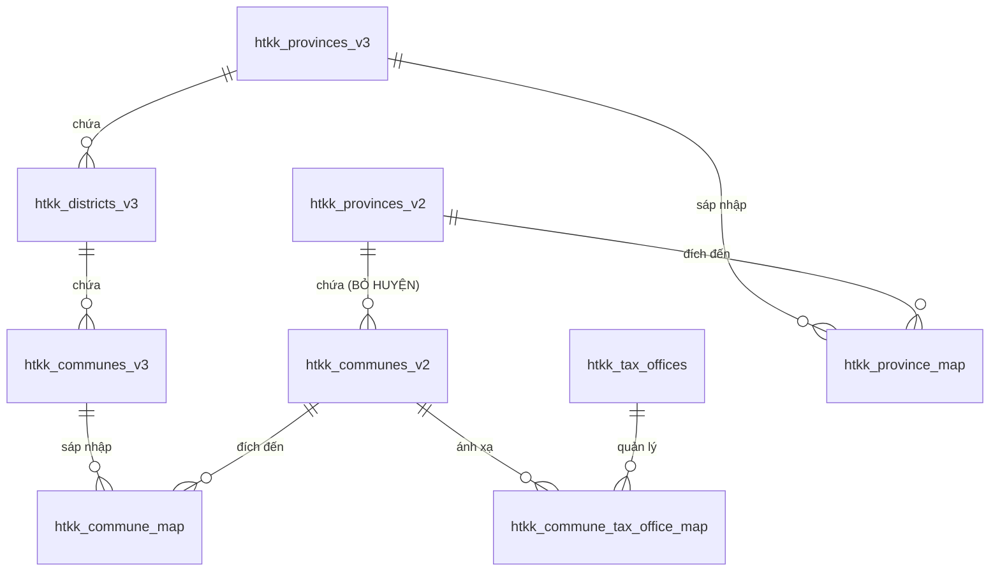

# Topic 04: Tích Hợp CSDL Địa Bàn Hành Chính & Cơ Quan Thuế HTKK (Mô Hình 3 Cấp & 2 Cấp)

## 1. Bối Cảnh & Mục Tiêu Kỹ Thuật

Trong quá trình quản lý dữ liệu người nộp thuế (NNT) với quy mô hàng triệu bản ghi, bài toán chuẩn hóa địa chỉ trụ sở và phân loại cơ quan thuế quản lý trực tiếp gặp thách thức lớn do sự thay đổi trong cấu trúc tổ chức hành chính quốc gia:
- **Mô hình chính quyền 3 cấp truyền thống (Có cấp Huyện):** Tỉnh/Thành phố $\rightarrow$ Quận/Huyện/Thị xã $\rightarrow$ Xã/Phường/Thị trấn. Tương ứng với bộ máy thuế gồm Cục Thuế $\rightarrow$ Chi cục Thuế Quận/Huyện.
- **Mô hình chính quyền 2 cấp cải cách (ĐÃ BỎ CẤP HUYỆN):** Tỉnh/Thành phố $\rightarrow$ Xã/Phường (**Cấp Huyện bị bãi bỏ**, giảm tầng nấc trung gian, sáp nhập đơn vị hành chính quy mô lớn). Tương ứng là hệ thống **Thuế cơ sở** trực thuộc Cục Thuế phụ trách các cụm địa bàn liên xã.

Thư mục `htkk/` chứa trọn bộ 137 tệp XML danh mục chuẩn từ phần mềm Hỗ Trợ Kê Khai (HTKK) của Tổng cục Thuế (phiên bản 526 $\rightarrow$ 537). Mục tiêu của Topic này là thiết kế lược đồ quan hệ chuẩn hóa trong PostgreSQL, thực hiện ETL nạp toàn bộ danh mục và cung cấp REST API tra cứu, chuyển đổi đa chiều.

---

## 2. Phân Tích Dữ Liệu Danh Mục HTKK

Qua phân tích 137 tệp XML, hệ thống xác định 3 nhóm dữ liệu cấu trúc:

```
htkk/
├── Mô Hình 3 Cấp (Có Cấp Huyện)
│   ├── Catalogue_Dia_Ban_Tinh.xml      # 64 Tỉnh/Thành phố truyền thống
│   ├── Catalogue_Dia_Ban_Huyen.xml     # 718 Quận/Huyện/Thị xã toàn quốc
│   └── Catalogue_Dia_Ban_Xa.xml        # 11.966 Xã/Phường (mã 7 chữ số)
│
├── Mô Hình 2 Cấp Cải Cách (ĐÃ BỎ CẤP HUYỆN)
│   ├── Catalogue_Dia_Ban_Tinh_Moi.xml  # 34 Tỉnh/TP mới sau quy hoạch sáp nhập
│   ├── Catalogue_Dia_Ban_Xa_Moi.xml    # 3.322 Xã/Phường mới (mã 8 chữ số, trực tiếp thuộc Tỉnh)
│   ├── Catalogue_CoQuanThu.xml         # 3.386 Cơ quan thuế & Mạng lưới Thuế cơ sở
│   └── Catalogue_CQThu_Dia_Ban.xml     # 3.383 Ánh xạ Xã mới -> Thuế cơ sở quản lý
│
└── Bảng Ánh Xạ Chuyển Đổi (Mapping / Bridge)
    ├── Catalogue_Dia_Ban_Tinh_Map.xml  # 63 Ánh xạ sáp nhập Tỉnh cũ -> Tỉnh mới
    ├── Catalogue_Dia_Ban_Xa_Map.xml    # Ánh xạ sáp nhập Xã cũ -> Xã mới
    └── Catalogue_CQT_Dia_Ban.xml       # Tra cứu CQT theo địa bàn
```

---

## 3. Kiến Trúc CSDL PostgreSQL (`htkk_*`)

Đã thiết kế và khởi tạo 8 bảng quan hệ chuẩn hóa cùng 1 View hợp nhất tại `src/db/migrations/003_create_htkk_tables.sql`:



### Các Bảng Thành Phần & Thống Kê Bản Ghi
1. **`htkk_provinces_v3` (64 bản ghi):** Mã tỉnh 3 số (`101` Hà Nội, `103` Hải Phòng...).
2. **`htkk_districts_v3` (718 bản ghi):** Mã huyện 5 số (`10101` Ba Đình, `10103` Tây Hồ...).
3. **`htkk_communes_v3` (11.966 bản ghi):** Mã xã 7 số (`1010101` Phường Phúc Xá...), cờ `is_expired`.
4. **`htkk_provinces_v2` (35 bản ghi):** 34 tỉnh/thành phố mới sau quy hoạch sáp nhập.
5. **`htkk_communes_v2` (3.322 bản ghi):** Mã xã 8 số (`10129087` Phường Sơn Tây), **trực thuộc tỉnh, bỏ cấp huyện**.
6. **`htkk_tax_offices` (3.386 bản ghi):** Danh mục Cục Thuế và Mạng lưới **Thuế cơ sở**.
7. **`htkk_commune_tax_office_map` (3.321 bản ghi):** Ánh xạ từng địa bàn xã mới sang Thuế cơ sở phụ trách trực tiếp.
8. **`htkk_province_map` (63 bản ghi):** Ánh xạ sáp nhập Tỉnh cũ sang Tỉnh mới.
9. **`v_htkk_administrative_mapping` (View 11.966 dòng):** View hợp nhất đa chiều liên kết từ 3 cấp sang 2 cấp và Cơ quan thuế.

---

## 4. Module Fastify REST API (`src/modules/htkk/`)

Toàn bộ logic tra cứu được đóng gói trong module TypeScript độc lập tuân thủ quy chuẩn `GEMINI.md`:

| Endpoint | Phương thức | Chức năng |
|:---|:---:|:---|
| `/api/htkk/stats` | `GET` | Thống kê số lượng bản ghi của 8 bảng danh mục |
| `/api/htkk/v3/provinces` | `GET` | Danh sách 63 tỉnh/thành phố theo mô hình 3 cấp |
| `/api/htkk/v3/districts/:provinceCode` | `GET` | Danh sách quận/huyện trực thuộc tỉnh (3 cấp) |
| `/api/htkk/v3/communes/:districtCode` | `GET` | Danh sách xã/phường trực thuộc quận/huyện (3 cấp) |
| `/api/htkk/v2/provinces` | `GET` | Danh sách 34 tỉnh/thành phố mới theo mô hình 2 cấp |
| `/api/htkk/v2/communes/:provinceCode` | `GET` | Danh sách xã/phường mới (**đã bỏ cấp huyện**) |
| `/api/htkk/tax-offices` | `GET` | Danh mục Cơ quan thuế / Mạng lưới Thuế cơ sở |
| `/api/htkk/mapping/:communeCode` | `GET` | Tra cứu ánh xạ chuyển đổi đa cấp & Thuế cơ sở phụ trách |

---

## 5. Bằng Chứng Nghiệm Thu & Kiểm Thử

### 5.1. Thống Kê Dữ Liệu Đã Nạp Vào PostgreSQL
```bash
curl -s http://localhost:8123/api/htkk/stats
```
Phản hồi:
```json
{
  "provincesV3Count": 64,
  "districtsV3Count": 718,
  "communesV3Count": 11966,
  "provincesV2Count": 35,
  "communesV2Count": 3322,
  "taxOfficesCount": 3386,
  "communeTaxOfficeMapCount": 3321,
  "provinceMapCount": 63,
  "communeMapCount": 19
}
```

### 5.2. Tra Cứu Ánh Xạ Xã Mới $\rightarrow$ Thuế Cơ Sở (Mô Hình 2 Cấp Đã Bỏ Huyện)
```bash
curl -s http://localhost:8123/api/htkk/mapping/10129087
```
Phản hồi:
```json
{
  "v3ProvinceCode": "101",
  "v3ProvinceName": "Thành phố Hà Nội",
  "v3DistrictCode": "",
  "v3DistrictName": "Đã bỏ cấp Huyện (Mô hình 2 cấp)",
  "v3CommuneCode": "10129087",
  "v3CommuneName": "Phường Sơn Tây",
  "v3CommuneIsExpired": false,
  "v2ProvinceCode": "101",
  "v2ProvinceName": "Thành phố Hà Nội",
  "v2CommuneCode": "10129087",
  "v2CommuneName": "Phường Sơn Tây",
  "taxOfficeCode": "1140759",
  "taxOfficeName": "Phường Sơn Tây - Thuế cơ sở 16 Thành phố Hà Nội"
}
```

### 5.3. Kiểm Thử Giới Hạn Dòng Code & Type Safety
- `npx tsx tests/check_ts_line_limits.ts`: **32/32 tệp PASS (100% < 200 dòng)**.
- `python -c "from test_modular import check_line_counts; check_line_counts()"`: **27/27 tệp PASS**.
- `npm run build`: **0 lỗi biên dịch, Strict Type Safety**.

---

## 6. Ánh Xạ Tự Động Dữ Liệu Thuế GDT với Địa Bàn 2 Cấp & 3 Cấp

### 6.1. Nguyên Lý Ánh Xạ (Data Mapping Engine)
- **Cơ sở dữ liệu đầu vào:** Bảng `tax_records` (6.88 triệu bản ghi) chứa `tran_dist` (Mã Huyện) và `pay_taxo_id` (Mã CQT).
- **Tỷ lệ khớp thực tế:** 6,883,019 / 6,888,728 (**99.92%**) bản ghi khớp chính xác tuyệt đối với `htkk_districts_v3.district_code`.
- **Phân giải Mô hình 3 cấp:**
  - Tỉnh V3 + Huyện V3: Phân giải trực tiếp từ `tran_dist` $\rightarrow$ `htkk_districts_v3` $\rightarrow$ `htkk_provinces_v3`.
  - Xã/Phường V3: Tự động trích xuất chuỗi từ `tran_addr` kết hợp danh sách xã trực thuộc huyện (`htkk_communes_v3`).
  - Cơ quan thuế V3: Xác định Chi cục Thuế Quận/Huyện hoặc Cục Thuế Tỉnh (đuôi `00`) từ `pay_taxo_id`.
- **Phân giải Mô hình 2 cấp (Cải cách Bãi bỏ cấp Huyện):**
  - Tỉnh mới V2: Ánh xạ chuyển đổi qua `htkk_province_map` $\rightarrow$ `htkk_provinces_v2`.
  - Cấp Huyện: Xác lập trạng thái **"Đã bãi bỏ cấp Huyện"**.
  - Xã mới V2: Ánh xạ qua `htkk_commune_map` / `htkk_communes_v2`.
  - Thuế cơ sở V2: Phân bổ mạng lưới **Thuế cơ sở** quản lý trực tiếp địa bàn thông qua `htkk_commune_tax_office_map`.

### 6.2. Endpoint API & Giao Diện Người Dùng
1. **API Phân giải:**
   - `GET /api/htkk/tax-record/:tin`: Phân giải đầy đủ 3 cấp & 2 cấp cho MST.
   - `GET /api/record/:tin`: Tự động trả kèm trường `htkk_mapping` cho frontend.
2. **Giao diện Modal Chi Tiết Người Nộp Thuế (`TaxDetailModal`):**
   - Tích hợp Card **"Đối Chiếu Địa Bàn & Mạng Lưới Thuế HTKK"**.
   - Cột trái: Mô hình 3 cấp (Tỉnh, Huyện, Xã, Chi cục Thuế).
   - Cột phải: Mô hình 2 cấp (Tỉnh mới, Huy hiệu ĐÃ BỎ CẤP HUYỆN, Thuế Cơ Sở quản lý).
